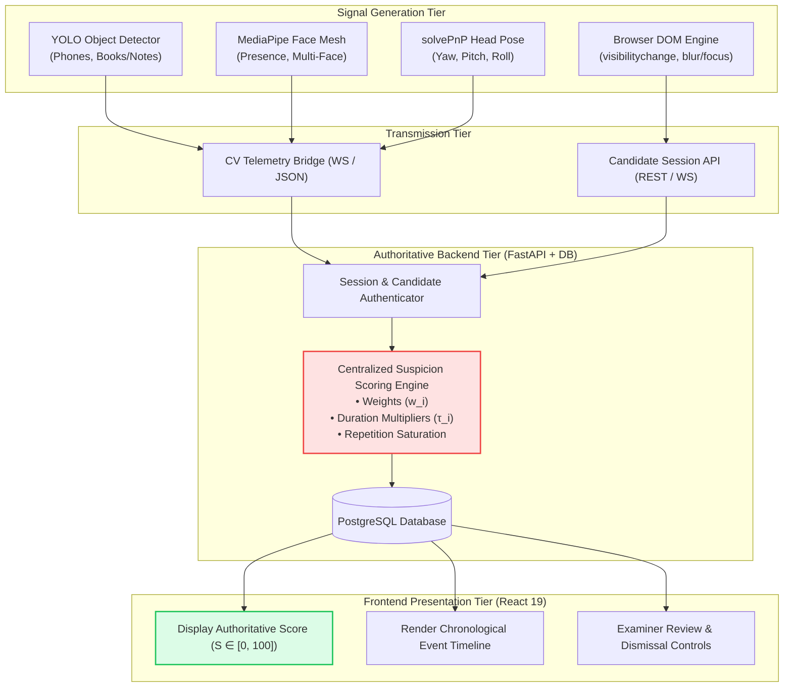
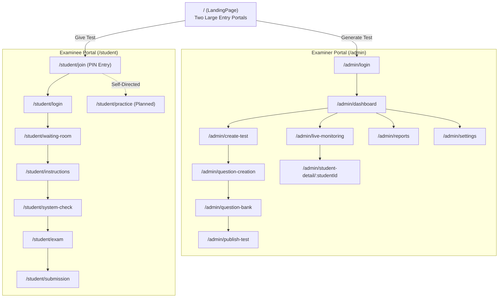
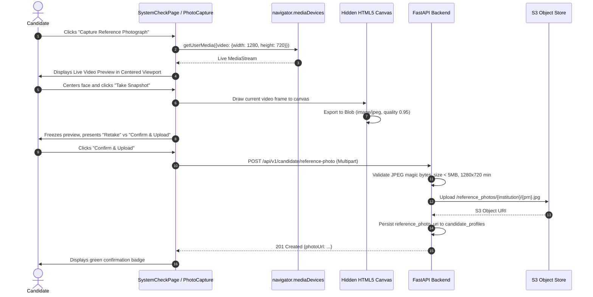
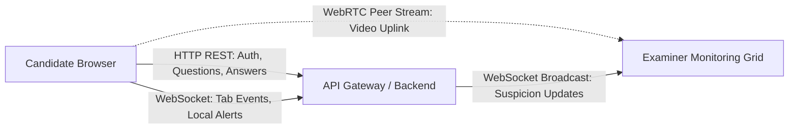
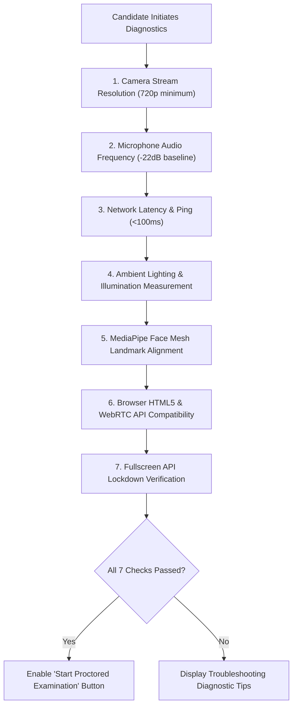
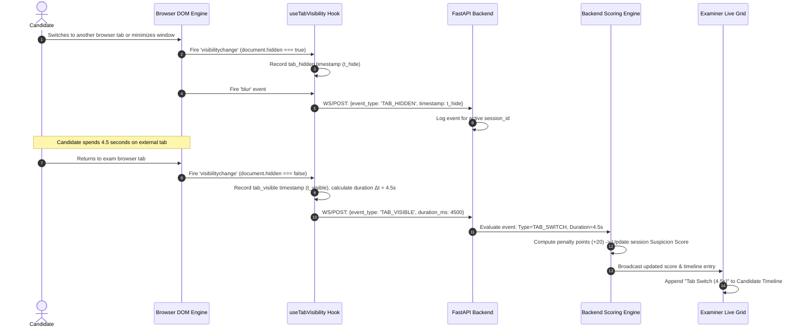
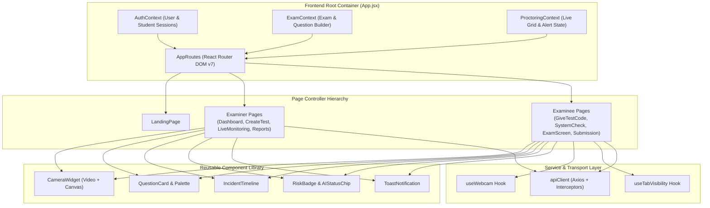
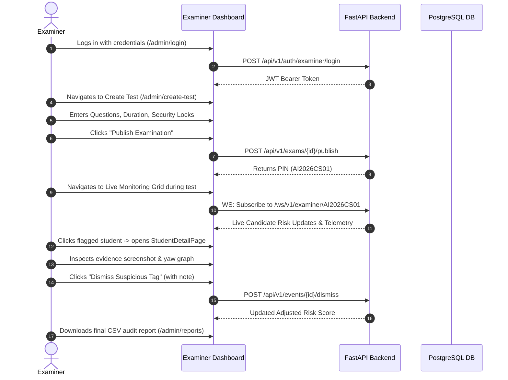
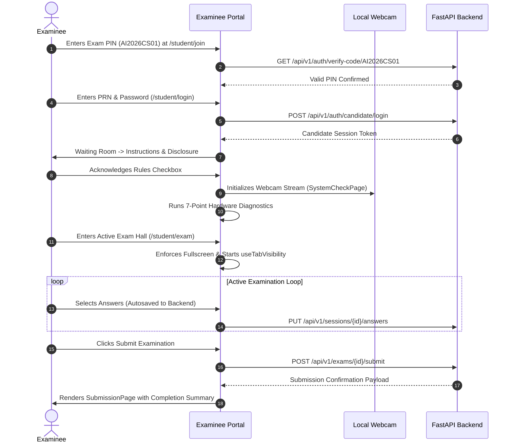

# IntelliProctor — Frontend Architecture & Technical Specification

> **Document Role**: Authoritative Specification for the Desired Frontend Architecture, User Experience (UX), Route Hierarchy, Component Boundaries, and Integration Contracts.  
> **Target Audience**: Frontend Engineers, AI Coding Agents, Full-Stack Architects, and UX Designers.  
> **Master Application Reference**: Root [`README.md`](file:///c:/Users/tanis/IntelliProctor/README.md).  
> **Audit Companion**: [`FRONTEND_CURRENT_STATE.md`](file:///c:/Users/tanis/IntelliProctor/FRONTEND_CURRENT_STATE.md).  
> **Status**: **TARGET SPECIFICATION** (Describes intended target architecture; see current audit for implemented vs. planned boundaries).  

---

## Table of Contents

1. [Purpose & Architectural Authority](#1-purpose--architectural-authority)
2. [Core Architectural Principle: Detection versus Scoring](#2-core-architectural-principle-detection-versus-scoring)
3. [Product & Visual Design Principles](#3-product--visual-design-principles)
   - [3.1 Role-Based Design Separation](#31-role-based-design-separation)
   - [3.2 Design Tokens & Visual Hierarchy](#32-design-tokens--visual-hierarchy)
   - [3.3 Status Indication & Non-Alarming Aesthetics](#33-status-indication--non-alarming-aesthetics)
4. [Application Structure, Navigation, & Route Map](#4-application-structure-navigation--route-map)
   - [4.1 High-Level Route Hierarchy](#41-high-level-route-hierarchy)
   - [4.2 Authentication & Route Guards](#42-authentication--route-guards)
   - [4.3 State Preservation During Active Testing](#43-state-preservation-during-active-testing)
5. [Authentication, Candidate Profile, & Identity Capture](#5-authentication-candidate-profile--identity-capture)
   - [5.1 Examiner Authentication Flow](#51-examiner-authentication-flow)
   - [5.2 Candidate Registration & Profile Definition](#52-candidate-registration--profile-definition)
   - [5.3 Live Webcam Reference Photograph Capture Flow](#53-live-webcam-reference-photograph-capture-flow)
   - [5.4 Photograph Storage, Retrieval, & Privacy Boundaries](#54-photograph-storage-retrieval--privacy-boundaries)
6. [Examiner Dashboard & Examination Creation](#6-examiner-dashboard--examination-creation)
   - [6.1 Examiner Command Center](#61-examiner-command-center)
   - [6.2 "Generate Test" vs. "Create Custom Test" Workflows](#62-generate-test-vs-create-custom-test-workflows)
   - [6.3 Examination Scheduling, Security Locks, & Passkey Generation](#63-examination-scheduling-security-locks--passkey-generation)
7. [Shared Virtual Examination Hall Architecture](#7-shared-virtual-examination-hall-architecture)
   - [7.1 The Logical Session Concept](#71-the-logical-session-concept)
   - [7.2 Real-Time Communication Layer (REST, WebSockets, WebRTC)](#72-real-time-communication-layer-rest-websockets-webrtc)
8. [Examiner Live Monitoring Interface](#8-examiner-live-monitoring-interface)
   - [8.1 Real-Time Candidate Grid](#81-real-time-candidate-grid)
   - [8.2 The Four Distinct Video and Data Streams](#82-the-four-distinct-video-and-data-streams)
   - [8.3 Candidate Detail Deep-Dive View](#83-candidate-detail-deep-dive-view)
9. [Examinee Dashboard & Examination Joining](#9-examinee-dashboard--examination-joining)
   - [9.1 Candidate Entry Portal](#91-candidate-entry-portal)
   - [9.2 PIN Passkey Validation & Admission Handshake](#92-pin-passkey-validation--admission-handshake)
10. [Pre-Examination Guidelines & Mandatory Disclosures](#10-pre-examination-guidelines--mandatory-disclosures)
    - [10.1 Policy Presentation & Prohibited Items](#101-policy-presentation--prohibited-items)
    - [10.2 Automated 7-Point Hardware & Environment Pre-Flight Diagnostics](#102-automated-7-point-hardware--environment-pre-flight-diagnostics)
11. [Examinee Active Examination Experience](#11-examinee-active-examination-experience)
    - [11.1 Distraction-Free Test View](#111-distraction-free-test-view)
    - [11.2 Question Palette & Answer Persistence](#112-question-palette--answer-persistence)
    - [11.3 Local Camera Widget & Notification Toasts](#113-local-camera-widget--notification-toasts)
12. [Browser-Based Tab-Switching & Visibility Monitoring](#12-browser-based-tab-switching--visibility-monitoring)
    - [12.1 Independent Browser Detection Mechanics](#121-independent-browser-detection-mechanics)
    - [12.2 Tab-Switch Event Payload Contract](#122-tab-switch-event-payload-contract)
    - [12.3 Authoritative Backend Scoring Responsibility](#123-authoritative-backend-scoring-responsibility)
    - [12.4 Technical Limitations, Edge Cases, & Tamper Proofing](#124-technical-limitations-edge-cases--tamper-proofing)
13. [Self-Directed Practice & Diagnostic Mode](#13-self-directed-practice--diagnostic-mode)
    - [13.1 Practice Session Workflow](#131-practice-session-workflow)
    - [13.2 Technical Diagnostic HUD (Head Pose, Mesh, & YOLO)](#132-technical-diagnostic-hud-head-pose-mesh--yolo)
14. [Proctoring Event Presentation Architecture](#14-proctoring-event-presentation-architecture)
    - [14.1 The Seven-Tier Event Taxonomy](#141-the-seven-tier-event-taxonomy)
    - [14.2 Frontend Presentation Invariants](#142-frontend-presentation-invariants)
15. [Evidence Review & Examiner Adjudication Workflow](#15-evidence-review--examiner-adjudication-workflow)
    - [15.1 Evidence Keyframe Inspection](#151-evidence-keyframe-inspection)
    - [15.2 Flag Dismissal Semantics & Audit Immutability](#152-flag-dismissal-semantics--audit-immutability)
16. [Comprehensive Results & Audit Reports](#16-comprehensive-results--audit-reports)
    - [16.1 Consolidated Examiner Reports](#161-consolidated-examiner-reports)
    - [16.2 Candidate Post-Exam Result View](#162-candidate-post-exam-result-view)
17. [Frontend Component Architecture & Reusability](#17-frontend-component-architecture--reusability)
    - [17.1 Component Categorization](#171-component-categorization)
    - [17.2 The Reusable `useTabVisibility` Hook Specification](#172-the-reusable-usetabvisibility-hook-specification)
18. [State Management & Data Ownership Boundary](#18-state-management--data-ownership-boundary)
19. [Frontend-to-Backend Integration Contracts](#19-frontend-to-backend-integration-contracts)
20. [UX States, Error Handling, & Resilience Patterns](#20-ux-states-error-handling--resilience-patterns)
21. [Accessibility, Responsiveness, & Cross-Platform Integrity](#21-accessibility-responsiveness--cross-platform-integrity)
22. [Architecture Diagrams & Journey Sequences](#22-architecture-diagrams--journey-sequences)
23. [Development Rules for Future Frontend Engineers & Agents](#23-development-rules-for-future-frontend-engineers--agents)

---

## 1. Purpose & Architectural Authority

This document defines the **target frontend architecture, design principles, user experience, and integration standards** for **IntelliProctor**.

- **Canonical Authority**: All future frontend development, refactoring, screen creation, and component styling must conform to the requirements specified herein alongside the master application [`README.md`](file:///c:/Users/tanis/IntelliProctor/README.md).
- **Scope**: Covers all browser-based user interfaces executed under `Frontend/`, including the Examiner Command Center, Candidate Examination Hall, Live Monitoring Grid, Hardware Diagnostic Pre-Flight Check, and Practice Diagnostic Lab.
- **Implementation Status Distinction**: This document details the **desired target architecture**. Where capabilities (e.g. WebSocket telemetry, live WebRTC streaming, backend scoring ingestion) are not yet operational in the codebase, they are explicitly marked as **Planned** or **Partially Implemented**. For an audit of what currently executes today, consult [`FRONTEND_CURRENT_STATE.md`](file:///c:/Users/tanis/IntelliProctor/FRONTEND_CURRENT_STATE.md).

---

## 2. Core Architectural Principle: Detection versus Scoring

A foundational tenet of IntelliProctor is the strict separation between **observed physical signals**, **debounced anomaly events**, **centralized suspicion scoring**, and **human adjudication**.



### 2.1 The Division of Responsibilities

#### Frontend Responsibilities:
1. Render the candidate examination interface, question palette, countdown timer, and answer controls.
2. Render the candidate's own local camera preview using the HTML5 `getUserMedia` API.
3. Observe browser Page Visibility API (`visibilitychange`) and focus/blur transitions during an active examination.
4. Package and transmit structured, timestamped tab-switch and focus events to the authenticated backend.
5. Display backend-generated alarms, anomaly timelines, and authoritative suspicion scores.
6. Provide authorized examiner controls to inspect evidence keyframes and record flag dismissals.
7. **Strict Prohibition**: The frontend must **NEVER independently calculate, increment, or invent the candidate suspicion score**. The frontend is purely a presentation client.

#### Computer-Vision Responsibilities:
1. Acquire webcam video frames asynchronously via [`video_input_analysis.py`](file:///c:/Users/tanis/IntelliProctor/video_input_analysis.py).
2. Execute object detection on clean frame buffers using YOLO11m for prohibited items (`phone`, `book`).
3. Extract 468 facial landmarks via MediaPipe Face Mesh and compute 3D head pose vectors ($[\text{Yaw}, \text{Pitch}, \text{Roll}]$) via `cv2.solvePnP`.
4. Apply geometric filters (aspect ratio, size) and multi-frame temporal debouncing via [`temporal_filter.py`](file:///c:/Users/tanis/IntelliProctor/temporal_filter.py).
5. Transmit debounced anomaly observations and evidence snapshots to the backend.

#### Backend Responsibilities:
1. Authenticate and cryptographically validate all incoming telemetry events.
2. Associate events immutably with the active `candidate_id`, `examination_id`, and `session_id`.
3. Apply the authoritative mathematical suspicion scoring formula across all event sources:
   - Event classification and base weights ($w_i$).
   - Duration scaling factors ($\tau_i$).
   - Repetition saturation limits ($C_{i,\max}$).
   - Corroborating signals (e.g., simultaneous head-turn + tab-switch).
4. Persist event records, evidence metadata, and audit logs in the PostgreSQL database.
5. Deliver authoritative suspicion scores, live alerts, and final reports to authorized frontend clients.

---

## 3. Product & Visual Design Principles

### 3.1 Role-Based Design Separation
IntelliProctor serves two fundamentally distinct personas requiring specialized UX paradigms:

1. **Examiner (Instructor / Proctor)**:
   - **UX Priority**: High information density, comprehensive monitoring grid, rapid triage capabilities, and immediate visual risk identification.
   - **Aesthetics**: Command-center dark/slate headers (`slate-900`, `indigo-950`), status badges, Recharts time-series graphs, and interactive data tables.
2. **Examinee (Candidate / Student)**:
   - **UX Priority**: Extreme focus, minimal cognitive load, zero non-essential clutter, clear typography, and calm, non-intrusive status feedback.
   - **Aesthetics**: Clean, distraction-minimizing canvases (`slate-50`, `white`), high-contrast question text (`slate-900`), and discrete floating toasts (`ToastNotification.jsx`) that inform without causing panic.

### 3.2 Design Tokens & Visual Hierarchy
The design system is implemented using Tailwind CSS v4 design tokens:

| Token Category | Token / Class | Hex / Value | Semantic Role |
| :--- | :--- | :--- | :--- |
| **Primary Brand** | `indigo-600` / `indigo-700` | `#4F46E5` / `#4338CA` | Primary CTAs, active route tabs, brand icons |
| **Surface Base** | `slate-50` / `white` | `#F8FAFC` / `#FFFFFF` | Main page background, card surfaces |
| **Border / Divider** | `slate-200` / `slate-100` | `#E2E8F0` / `#F1F5F9` | Clean structural dividing lines |
| **Text Primary** | `slate-900` | `#0F172A` | Headings, question prompts, candidate names |
| **Text Secondary** | `slate-500` / `slate-600` | `#64748B` / `#475569` | Explanatory labels, timestamps, metadata |
| **Safe Status** | `emerald-500` / `emerald-600` | `#10B981` / `#059669` | Compliant proctoring status, verified checks, attempted questions |
| **Warning Status** | `amber-500` / `amber-600` | `#F59E0B` / `#D97706` | Moderate risk, head pose deviation, marked for review |
| **Critical Status** | `red-500` / `red-600` | `#EF4444` / `#DC2626` | Prohibited object detected, absence $>10\text{s}$, critical risk |
| **Rounded Geometry**| `rounded-2xl` / `rounded-3xl`| `1rem` / `1.5rem` | Soft, modern, approachable card containers |

### 3.3 Status Indication & Non-Alarming Aesthetics
- **Routine Observations**: Ordinary tracking feedback (e.g. subtle head yaw or transient lighting shift) must **never display flashing red banners or sound jarring chimes** to the examinee.
- **Examiner Visual States**:
  - `Safe` ($\text{Risk} \le 20$): Subdued emerald chip.
  - `Warning` ($21 \le \text{Risk} \le 50$): Amber chip with incident count.
  - `Critical` ($\text{Risk} > 50$): High-visibility red ring and urgent badge.
  - `Dismissed`: Strikethrough indicator with muted slate chip showing review justification.

---

## 4. Application Structure, Navigation, & Route Map

### 4.1 High-Level Route Hierarchy
All frontend navigation originates from [`AppRoutes.jsx`](file:///c:/Users/tanis/IntelliProctor/Frontend/src/routes/AppRoutes.jsx):



### 4.2 Authentication & Route Guards
Target architecture requires two strict React Router Guard wrappers:
1. `<RequireExaminerAuth>`:
   - Validates `user.role === 'EXAMINER'` and bearer token validity.
   - Redirects unauthenticated users to `/admin/login` with `state: { from: location }`.
2. `<RequireCandidateSession>`:
   - Validates active `studentSession.token`, valid `examCode`, and pre-flight check completion.
   - Blocks direct URL navigation to `/student/exam` if the candidate has not completed `/student/system-check`.

### 4.3 State Preservation During Active Testing
If a candidate accidentally reloads the browser tab during an active test:
- The exam session must **recover immediately** without zeroing answers or restarting the countdown timer.
- Candidate answers must be stored in `localStorage` under an encrypted key: `intelliproctor_draft_{examId}_{candidateId}`.
- The backend remains the source of truth for the session expiration timestamp (`expires_at`), preventing timer tampering via client clock adjustments.

---

## 5. Authentication, Candidate Profile, & Identity Capture

### 5.1 Examiner Authentication Flow
- Access route: `/admin/login`.
- Input fields: Institutional Email Address, Password, Remember Me toggle.
- Handled via `authApi.loginSetter`: Authenticates credentials against `/api/v1/auth/examiner/login`, returning an `access_token` stored securely in HTTP-only cookies or encrypted local storage.

### 5.2 Candidate Registration & Profile Definition
The candidate profile decouples academic identity from proctoring session metadata:
- **Academic Identifiers**: Institutional PRN / Roll Number (e.g. `2026-CS-042`), Full Name, College / Institution Name.
- **Session Credentials**: Session password or Single Sign-On (SSO) assertion.

### 5.3 Live Webcam Reference Photograph Capture Flow
Prior to candidate admission, the registration / pre-exam pipeline requires capturing a high-resolution reference photograph:



### 5.4 Photograph Storage, Retrieval, & Privacy Boundaries
- **Storage Strategy**: Encrypted at rest (`AES-256`) in private cloud object storage. Never committed to source control or logged in telemetry.
- **Authorized Retrieval**: Rendered in the examiner's candidate profile view via short-lived, pre-signed URLs ($15$-minute expiry).
- **Distinction from Automated Face Recognition**: Storing a reference photograph allows human examiners to verify candidate identity visually. It does **not imply automated 1:1 facial embedding matching** unless an explicit biometric verification service is authorized and integrated.

---

## 6. Examiner Dashboard & Examination Creation

### 6.1 Examiner Command Center
The Examiner Dashboard ([`DashboardPage.jsx`](file:///c:/Users/tanis/IntelliProctor/Frontend/src/pages/admin/DashboardPage.jsx)) provides a modular landing view featuring:
- **Quick-Launch Module Cards**: Create Test, Question Bank, Live Monitoring Grid, Reports, Settings.
- **Platform Analytics**: Total Exams Created, Registered Students, Active Live Sessions, Flagged Candidates.
- **Recent Examination Catalog**: Status badges (`Active`, `Scheduled`, `Completed`), average suspicion risk score, and quick actions (Monitor, Edit, Report).

### 6.2 "Generate Test" vs. "Create Custom Test" Workflows
The platform provides two distinct test construction workflows:

#### Workflow A: Generate Test (AI / Question Bank Driven)
- Examiner specifies subject topic, target difficulty breakdown (e.g. 40% Easy, 40% Medium, 20% Hard), and total question count.
- The backend or question bank automatically samples matching questions.
- Examiner reviews and edits generated questions prior to publication.

#### Workflow B: Create Custom Test (Manual Authoring)
- Supported in [`CreateTestPage.jsx`](file:///c:/Users/tanis/IntelliProctor/Frontend/src/pages/admin/CreateTestPage.jsx) and [`QuestionCreationPage.jsx`](file:///c:/Users/tanis/IntelliProctor/Frontend/src/pages/admin/QuestionCreationPage.jsx).
- Google Forms-style dynamic builder supporting:
  - **MCQ (Single Choice)**: 4 options with radio selection.
  - **True / False**: Binary toggle.
  - **Fill in the Blank**: Exact string matching.
  - **Subjective / Short Answer**: Open text prompt with rubric guidelines.
- Dynamic question manipulation: Add New, Duplicate, Delete, Reorder, Marks per question.

### 6.3 Examination Scheduling, Security Locks, & Passkey Generation
Located in [`PublishTestPage.jsx`](file:///c:/Users/tanis/IntelliProctor/Frontend/src/pages/admin/PublishTestPage.jsx):
- **Examination Parameters**: Title, subject department, duration in minutes, scheduled calendar date, and launch time.
- **Security Lock Toggles**:
  - `aiMonitoring`: Enforces YOLO and MediaPipe CV proctoring.
  - `browserLock`: Enforces fullscreen lockdown and logs tab-switch violations.
  - `audioMonitoring`: Tracks ambient background noise spikes.
  - `shuffleQuestions` & `shuffleOptions`: Randomizes question sequence per candidate.
  - `negativeMarking`: Penalizes incorrect objective answers (e.g. $-0.25$).
- **Passkey Generation**:
  - Generates a unique, high-entropy 10-character code (e.g. `AI2026CS01`) via `generateExamCode()`.
  - Displays formatted code banner, single-click copy button, and QR code representation.
  - Generates student direct invitation link: `https://exam.domain/student/join?code=AI2026CS01`.

---

## 7. Shared Virtual Examination Hall Architecture

### 7.1 The Logical Session Concept
The "Virtual Examination Hall" is an **application-level logical session**, not a single physical server process. It binds:
- One published `examination_id` and unique `passkey_code`.
- One authorized `examiner_id` operating the monitoring dashboard.
- Multiple enrolled candidates, each running an isolated browser instance with their own webcam feed, question state, and proctoring telemetry pipeline.

### 7.2 Real-Time Communication Layer (REST, WebSockets, WebRTC)
To support live multi-candidate examination halls, the frontend utilizes three complementary transport layers:



1. **REST APIs**: Stateless CRUD operations (joining, question fetching, answer autosaving, submission).
2. **WebSocket Telemetry Channel**: Bi-directional, low-latency transport for structured event payloads (tab switches, head-turn warnings, risk updates).
3. **WebRTC Media Transport**: Peer-to-peer or SFU-routed video feed streaming candidate camera frames to the examiner grid.

---

## 8. Examiner Live Monitoring Interface

### 8.1 Real-Time Candidate Grid
Implemented in [`LiveMonitoringPage.jsx`](file:///c:/Users/tanis/IntelliProctor/Frontend/src/pages/admin/LiveMonitoringPage.jsx):
- **Responsive Examinee Matrix**: Renders candidate live cards (`StudentLiveCard.jsx`) in a multi-column responsive grid.
- **Triage Filter Toolbar**:
  - `All`: Full roster.
  - `Critical`: Displays only candidates with active critical flags (e.g. phone detected, multiple persons, suspicion score $>50$).
  - `Warning`: Displays candidates with moderate deviations (head turned, ambient noise).
  - `Safe`: Compliant candidates.
- **Search Filter**: Search by candidate full name or institutional PRN.

### 8.2 The Four Distinct Video and Data Streams
The frontend interface maintains strict architectural separation between four data streams to avoid network congestion:

| Stream Designation | Source | Protocol / Transport | Consumer | Rendering Mechanism |
| :--- | :--- | :--- | :--- | :--- |
| **Stream 1: Local Preview** | Examinee Webcam | In-memory `MediaStream` | Candidate UI | `<video>` element (`autoplay, muted`) |
| **Stream 2: Canvas Overlay** | Client Logic / CV | Direct 2D Canvas Context | Candidate / Examiner | `<canvas>` overlay (`requestAnimationFrame`) |
| **Stream 3: Structured Telemetry**| CV & Browser DOM | WebSocket JSON packets | Backend & Examiner UI| Text badges, status chips, Recharts graphs |
| **Stream 4: Evidence Keyframes** | CV Triggered Snapshot| HTTPS / S3 Object Storage | Examiner Audit View | Pre-signed JPEG images with bounding boxes |

### 8.3 Candidate Detail Deep-Dive View
Implemented in [`StudentDetailPage.jsx`](file:///c:/Users/tanis/IntelliProctor/Frontend/src/pages/admin/StudentDetailPage.jsx):
- **High-Definition Stream View**: Large camera viewport with active status overlay.
- **Recharts Temporal Graph**: Visualizes Suspicion Risk Score % and Head Yaw Angle over the examination duration.
- **3D Head Pose Vector**: Real-time Euler angles ($[\text{Yaw}, \text{Pitch}, \text{Roll}]$).
- **Incident Timeline (`IncidentTimeline.jsx`)**: Chronological audit trail of timestamped alerts.
- **Examiner Triage Actions**:
  - `Flag Candidate`: Manually elevate candidate status to Critical with custom note.
  - `Dismiss Event`: Adjudicate false alarms.
  - `Generate PDF Report`: Export complete session audit.

---

## 9. Examinee Dashboard & Examination Joining

### 9.1 Candidate Entry Portal
Accessed via `/student/join` ([`GiveTestCodePage.jsx`](file:///c:/Users/tanis/IntelliProctor/Frontend/src/pages/student/GiveTestCodePage.jsx)):
- Centered, Kahoot-inspired large PIN input box.
- Enforces uppercase alphanumeric formatting.

### 9.2 PIN Passkey Validation & Admission Handshake
1. Candidate inputs examination code (e.g. `AI2026CS01`).
2. Frontend dispatches `authApi.verifyExamCode(code)`.
3. If valid, navigates to `/student/login?code=AI2026CS01`.
4. Candidate provides institutional PRN and password.
5. Candidate enters Waiting Room (`/student/waiting-room`) until the scheduled launch time.

---

## 10. Pre-Examination Guidelines & Mandatory Disclosures

### 10.1 Policy Presentation & Prohibited Items
Implemented in [`InstructionsPage.jsx`](file:///c:/Users/tanis/IntelliProctor/Frontend/src/pages/student/InstructionsPage.jsx):
- Visual cards displaying prohibited items:
  - 🚫 Mobile Phones & Smart Gadgets
  - 🚫 Physical Textbooks & Written Notes
  - 🚫 Second Persons in Background
  - 🚫 Leaving Fullscreen / Tab Switching
- **Mandatory Policy Checkbox**: Candidate must check *"I hereby agree and pledge to abide by all examination guidelines... I understand my webcam and workspace are monitored"* before proceeding.

### 10.2 Automated 7-Point Hardware & Environment Pre-Flight Diagnostics
Implemented in [`SystemCheckPage.jsx`](file:///c:/Users/tanis/IntelliProctor/Frontend/src/pages/student/SystemCheckPage.jsx):



---

## 11. Examinee Active Examination Experience

### 11.1 Distraction-Free Test View
Implemented in [`ExamScreenPage.jsx`](file:///c:/Users/tanis/IntelliProctor/Frontend/src/pages/student/ExamScreenPage.jsx):
- **Fullscreen Enforcement**: Requests `document.documentElement.requestFullscreen()` on entry.
- **Header Bar**: Displays exam title, PIN, active countdown timer (`useTimer`), and compliance status badge.
- **Copy/Paste Lockdown**: Disables text selection (`select-none`), right-click context menu, and keyboard shortcuts (`Ctrl+C`, `Ctrl+V`, `F12`).

### 11.2 Question Palette & Answer Persistence
- **Question Card (`QuestionCard.jsx`)**: Renders active question prompt, difficulty, allotted marks, and interactive option radios.
- **Question Palette (`QuestionPalette.jsx`)**: Color-coded matrix:
  - 🟩 Green: Attempted & Saved
  - 🟪 Purple: Marked for Review
  - 🟧 Amber: Visited but Unanswered
  - ⬜ Gray: Unvisited
- **Local Persistence**: Answers cached immediately to prevent loss during network blips.

### 11.3 Local Camera Widget & Notification Toasts
- **Webcam Preview (`CameraWidget.jsx`)**: Floats unobtrusively in the screen corner.
- **Non-Intrusive Floating Toasts (`ToastNotification.jsx`)**: Renders system warnings (e.g. *"Please face the screen"*, *"Browser window blurred"*) for 4 seconds before auto-dismissal.

---

## 12. Browser-Based Tab-Switching & Visibility Monitoring

### 12.1 Independent Browser Detection Mechanics
Tab switching is **completely independent of the Computer Vision pipeline**. It requires no YOLO inference, no MediaPipe tracking, and no GPU hardware.

It is monitored via the browser's native **Page Visibility API** and window focus events:
1. `document.addEventListener('visibilitychange', handleVisibilityChange)`
2. `window.addEventListener('blur', handleWindowBlur)`
3. `window.addEventListener('focus', handleWindowFocus)`



### 12.2 Tab-Switch Event Payload Contract
Transmitted to `/api/v1/monitoring/events/tab-switch`:

```json
{
  "session_id": "sess-84f92a10-2026",
  "candidate_id": "cand-2026-cs-042",
  "event_type": "TAB_HIDDEN",
  "client_timestamp": "2026-10-19T22:45:12.104Z",
  "duration_ms": 4500,
  "metadata": {
    "visibility_state": "hidden",
    "window_has_focus": false,
    "screen_width": 1920,
    "screen_height": 1080
  }
}
```

### 12.3 Authoritative Backend Scoring Responsibility
- The frontend **MUST NOT calculate suspicion penalty points** for a tab switch.
- The backend evaluates the event based on:
  1. Total frequency of occurrences ($N_{\text{tabs}}$).
  2. Duration of absence ($\Delta t$). Brief blips ($<1\text{s}$) caused by system notifications are treated as minor warnings, while sustained absence ($>10\text{s}$) is elevated to Critical.
  3. Correlation with other signals (e.g. head yaw turned left while tab switched).

### 12.4 Technical Limitations, Edge Cases, & Tamper Proofing
- **Limitation**: Browser visibility APIs cannot detect what the candidate looked at on a secondary physical monitor or smartphone.
- **Tamper Proofing**: Client timestamps are treated as untrusted; the backend records its own server-side reception timestamp ($t_{\text{server}}$) to detect client clock spoofing.
- **Offline Resiliency**: If network drops during a tab switch, the event is queued in an IndexedDB/localStorage retry buffer and flushed upon reconnection.

---

## 13. Self-Directed Practice & Diagnostic Mode

### 13.1 Practice Session Workflow
- Route: `/student/practice` (Planned).
- Allows candidates to take sample assessments without requiring an examiner-generated passkey.
- Provides immediate post-test feedback on both question performance and proctoring posture.

### 13.2 Technical Diagnostic HUD (Head Pose, Mesh, & YOLO)
Unlike formal exams where internal model overlays are hidden, Practice Mode enables a **Technical Heads-Up Display (HUD)**:
- Renders live 468-point facial mesh wireframes.
- Displays Euler angle readouts: $\text{Yaw: } +2.4^\circ, \text{ Pitch: } -1.2^\circ, \text{ Roll: } 0.0^\circ$.
- Displays YOLO bounding boxes with class probabilities (e.g. `cell phone: 0.88`).
- Explains why an alert triggers (e.g. *"Aspect ratio filter accepted candidate box"*).

---

## 14. Proctoring Event Presentation Architecture

### 14.1 The Seven-Tier Event Taxonomy

```
[Level 1: Raw Observation]     Unfiltered model coordinates or DOM event
         ↓
[Level 2: Anomaly Event]       Observation passing geometric & temporal threshold
         ↓
[Level 3: Live Alert]          UI notification toast or badge update
         ↓
[Level 4: Suspicion Score]     Authoritative backend risk metric (0 to 100)
         ↓
[Level 5: Evidence Keyframe]   Cryptographically hashed JPEG snapshot
         ↓
[Level 6: Human Review]        Examiner ratification or dismissal record
         ↓
[Level 7: Final Audit Report]  Authoritative post-exam transcript
```

### 14.2 Frontend Presentation Invariants
1. **Never conflate signals**: A head-pose deviation must not be labeled as "Cheating Detected". It must be labeled as "Head Pose Deviation (Yaw: $34^\circ$)".
2. **Never calculate scores in React**: All displayed risk scores must originate from `backendScore`.
3. **Preserve audit history**: Dismissing an event updates its review status chip, but never deletes it from the timeline.

---

## 15. Evidence Review & Examiner Adjudication Workflow

### 15.1 Evidence Keyframe Inspection
Located in [`StudentDetailPage.jsx`](file:///c:/Users/tanis/IntelliProctor/Frontend/src/pages/admin/StudentDetailPage.jsx):
- Clicking any incident in `IncidentTimeline.jsx` opens the high-resolution evidence inspector.
- Displays:
  - Clean frame and bounding-box annotated frame.
  - Model confidence score (e.g. $94.2\%$).
  - Exact UTC timestamp and time-elapsed counter.
  - Head pose angles and audio decibel levels at that instant.

### 15.2 Flag Dismissal Semantics & Audit Immutability
When an examiner determines a flag was a false positive (e.g., student holding an asthma inhaler misclassified as a phone):
1. Examiner clicks **"Dismiss Suspicious Tag"**.
2. Mandatory modal prompts for justification text (minimum 10 characters).
3. Frontend dispatches `POST /api/v1/monitoring/events/{id}/dismiss` with `{ justification: "..." }`.
4. Backend marks `is_dismissed = true`, logs `ExaminerReviewDecision`, and recalculates adjusted suspicion score.
5. Frontend updates timeline chip to **Dismissed** with strikethrough, displaying examiner rationale on hover.

---

## 16. Comprehensive Results & Audit Reports

### 16.1 Consolidated Examiner Reports
Implemented in [`ReportsPage.jsx`](file:///c:/Users/tanis/IntelliProctor/Frontend/src/pages/admin/ReportsPage.jsx):
- Tabular roster of all completed exams.
- Displays: Total Examinees, Average Score %, Average Suspicion Score %, Flagged Incidents Count, Completion Rate %.
- Single-click CSV / PDF export via `reportApi.downloadReportCSV`.

### 16.2 Candidate Post-Exam Result View
Implemented in [`SubmissionPage.jsx`](file:///c:/Users/tanis/IntelliProctor/Frontend/src/pages/student/SubmissionPage.jsx):
- Candidate views their own:
  - Total Attempted / Skipped questions.
  - Submission timestamp.
  - Summary of security flags logged (without revealing examiner notes or protected answer keys).

---

## 17. Frontend Component Architecture & Reusability

### 17.1 Component Categorization

```
Frontend/src/components/
├── common/                     # Shared UI Primitives
│   ├── AIStatusChip.jsx        # Pill displaying AI signals (Face, Phone, Book, Gaze)
│   ├── Navbar.jsx              # Role-aware sticky navigation bar
│   ├── RiskBadge.jsx           # Color-coded risk score badge (Safe, Warning, Critical)
│   └── ToastNotification.jsx   # Non-intrusive floating alert toasts
├── dashboard/                  # Examiner Dashboard Components
│   ├── QuickActionCard.jsx     # High-impact clickable module cards
│   └── StatsCard.jsx           # Metric visualization cards with trends
├── exam/                       # Active Examination Components
│   ├── CameraWidget.jsx        # Local video stream with HTML5 Canvas overlay engine
│   ├── QuestionCard.jsx        # Question prompt, difficulty chip, option radios
│   └── QuestionPalette.jsx     # Color-coded question status navigation matrix
└── monitoring/                 # Live Proctoring Components
    ├── IncidentTimeline.jsx    # Chronological event audit feed
    └── StudentLiveCard.jsx     # Candidate video thumbnail card for examiner grid
```

### 17.2 The Reusable `useTabVisibility` Hook Specification
To prevent code duplication, browser tab monitoring must be encapsulated in a reusable custom hook:

```javascript
// Target Specification: Frontend/src/hooks/useTabVisibility.js
import { useEffect, useRef } from 'react';

export const useTabVisibility = ({ onTabHidden, onTabVisible, onBlur, onFocus, enabled = true }) => {
  const hideTimeRef = useRef(null);

  useEffect(() => {
    if (!enabled) return;

    const handleVisibilityChange = () => {
      if (document.hidden) {
        hideTimeRef.current = performance.now();
        if (onTabHidden) onTabHidden({ timestamp: new Date().toISOString() });
      } else {
        const durationMs = hideTimeRef.current ? Math.round(performance.now() - hideTimeRef.current) : 0;
        hideTimeRef.current = null;
        if (onTabVisible) onTabVisible({ timestamp: new Date().toISOString(), durationMs });
      }
    };

    const handleBlur = () => { if (onBlur) onBlur({ timestamp: new Date().toISOString() }); };
    const handleFocus = () => { if (onFocus) onFocus({ timestamp: new Date().toISOString() }); };

    document.addEventListener('visibilitychange', handleVisibilityChange);
    window.addEventListener('blur', handleBlur);
    window.addEventListener('focus', handleFocus);

    return () => {
      document.removeEventListener('visibilitychange', handleVisibilityChange);
      window.removeEventListener('blur', handleBlur);
      window.removeEventListener('focus', handleFocus);
    };
  }, [enabled, onTabHidden, onTabVisible, onBlur, onFocus]);
};
```

---

## 18. State Management & Data Ownership Boundary

| State Entity | Owning Scope | Persistence Target | Authority |
| :--- | :--- | :--- | :---: |
| **Auth Credentials & Tokens**| `AuthContext.jsx` | `localStorage` / Cookie | Backend (JWT) |
| **Draft Exam Configuration**| `ExamContext.jsx` | `localStorage` draft cache | Examiner UI |
| **Published Examination** | `ExamContext.jsx` | PostgreSQL DB | Backend |
| **Candidate Answers** | `ExamScreenPage.jsx` | `localStorage` + REST Autosave | Candidate UI |
| **Question Answer Keys** | Backend Only | PostgreSQL DB | Backend (Protected) |
| **Local Webcam Stream** | `useWebcam.js` | Browser Memory (`MediaStream`)| Browser Hardware |
| **YOLO & MediaPipe Detections**| CV Process | Background Memory Buffer | CV Engine |
| **Tab-Switch Events** | `useTabVisibility.js`| Transient DOM Events | Browser DOM |
| **Suspicion Score ($S$)** | Backend API | PostgreSQL DB | **Backend Strictly**|
| **Evidence Keyframes** | S3 Storage Service | Object Store Bucket | Backend / S3 |
| **Examiner Review State** | Backend API | PostgreSQL DB | Examiner Reviewer |

---

## 19. Frontend-to-Backend Integration Contracts

| Contract Description | HTTP / WS Route | Payload Summary | Response / Effect | Status |
| :--- | :--- | :--- | :--- | :---: |
| **Examiner Login** | `POST /api/v1/auth/examiner/login` | `{ email, password }` | Returns JWT Bearer token | **Planned** |
| **Candidate Login** | `POST /api/v1/auth/candidate/login`| `{ prn, examCode, password }` | Returns Candidate session JWT | **Planned** |
| **Verify PIN Passkey** | `GET /api/v1/auth/verify-code/{code}`| None | `{ valid: bool, examTitle, ... }` | **Planned** |
| **Upload Reference Photo** | `POST /api/v1/candidate/reference-photo`| Multipart JPEG image | `{ photo_uri: string }` | **Planned** |
| **Fetch Questions** | `GET /api/v1/exams/{id}/questions` | None (Bearer token) | Array of questions without answer keys | **Planned** |
| **Autosave Answer** | `PUT /api/v1/sessions/{id}/answers` | `{ question_id, selected_opt }` | `{ status: "saved", timestamp }` | **Planned** |
| **Submit Examination** | `POST /api/v1/exams/{id}/submit` | `{ answers: { q1: "B", ... } }` | Final submission confirmation | **Planned** |
| **Report Tab-Switch Event** | `POST /api/v1/monitoring/events/tab-switch`| `{ event_type, duration_ms }` | Evaluated by scoring engine | **Planned** |
| **Live Telemetry Stream** | `WS /ws/v1/proctoring/{session_id}` | Real-time JSON telemetry packets | Ingests CV & DOM events | **Planned** |
| **Examiner Grid Stream** | `WS /ws/v1/examiner/{exam_code}` | None | Broadcasts live candidate status | **Planned** |
| **Dismiss Flag** | `POST /api/v1/events/{id}/dismiss` | `{ justification: string }` | Recalculates adjusted risk score | **Planned** |
| **Download CSV Report** | `GET /api/v1/reports/{id}/download`| None | Binary CSV file blob | **Planned** |

---

## 20. UX States, Error Handling, & Resilience Patterns

| Failure Scenario | UI Presentation | Recovery / Mitigation Action |
| :--- | :--- | :--- |
| **Camera Permission Denied** | Modal alert with browser permission guide | Blocks exam start until permission granted |
| **Camera Disconnected Mid-Exam**| Prominent amber warning banner | Triggers "Camera Offline" event; prompts reconnect |
| **Network Disconnection** | Non-blocking toast: *"Connection lost. Answers cached locally."* | Queues answers & telemetry in IndexedDB; flushes on reconnect |
| **Invalid Exam PIN** | Red inline form error: *"Invalid or inactive PIN"* | Clears input; maintains focus on PIN box |
| **Session Expiry** | Modal overlay: *"Examination time expired"* | Automatically dispatches final answer submission |
| **Backend Telemetry Offline** | Subtle indicator on monitoring grid: *"Live sync delayed"* | Reconnects WebSocket with exponential backoff (1s, 2s, 4s, 8s) |
| **Tab-Switch Failed Delivery** | Event buffered in client queue | Flushes payload immediately on next successful handshake |
| **Unsaved Answer Conflict** | Visual retry spinner on Question Palette | Compares server vs client timestamp before overwriting |

---

## 21. Accessibility, Responsiveness, & Cross-Platform Integrity

- **Accessibility (WCAG 2.1 AA Compliance)**:
  - Form controls have explicit `<label>` tags and `aria-label` attributes.
  - Full keyboard navigation: Questions selectable via numeric keys (`1`, `2`, `3`, `4`), Next (`ArrowRight`), Previous (`ArrowLeft`).
  - Color contrast ratio $\ge 4.5:1$ for all body text against slate backgrounds.
- **Responsive Layout Breakpoints**:
  - `Mobile (<640px)`: Stacked single-column layout, bottom-drawer question palette.
  - `Tablet (640px–1024px)`: Two-column layout with collapsible camera widget.
  - `Desktop (>1024px)`: Standard three-column layout (Navigation, Active Question, Live Camera & Palette).

---

## 22. Architecture Diagrams & Journey Sequences

### 22.1 High-Level Frontend Module Architecture



### 22.2 Examiner Complete Lifecycle Journey



### 22.3 Examinee Complete Lifecycle Journey



---

## 23. Development Rules for Future Frontend Engineers & Agents

> [!IMPORTANT]
> All engineers and automated coding agents modifying `Frontend/` must strictly enforce these 19 rules.

1. **Read Canonical Documents**: Read the root `README.md`, `FRONTEND_ARCHITECTURE.md`, and `FRONTEND_CURRENT_STATE.md` before making architectural or code modifications.
2. **Target vs. Implementation Distinction**: Treat this document as the canonical target specification, but never claim a feature is operational without inspecting the actual code.
3. **Preserve Framework Conventions**: Maintain Vite, React 19, Tailwind CSS v4, and React Router DOM v7 conventions.
4. **Strict Role-Based Boundary**: Maintain strict separation between Examiner (`/admin/*`) and Examinee (`/student/*`) routes, components, and permissions.
5. **Enforce Backend Authorization**: Never rely solely on client-side route guards. Access control must be enforced authoritatively on the backend.
6. **Reuse Existing CV Engine**: Do not duplicate YOLO or MediaPipe logic in JavaScript. The frontend connects to the Python CV pipeline via standardized network telemetry.
7. **Local Preview $\neq$ Remote Streaming**: A functioning local camera preview via `getUserMedia` does NOT mean remote examiner streaming is working. Maintain the distinction between Stream 1 (Local) and Stream 3/4 (Remote).
8. **Independent Tab-Switch Detection**: Implement tab-switch monitoring via the native Page Visibility API (`visibilitychange`), completely independent of YOLO and MediaPipe.
9. **Authenticated Session Association**: All client-observed visibility events must be transmitted to the backend bound to an authenticated `session_id`.
10. **Client Events Are Not Tamper-Proof**: Treat client-reported tab switches as observations, not irrefutable proof of misconduct.
11. **Frontend Must Never Calculate Suspicion Scores**: The frontend must **NEVER independently calculate, increment, or invent the candidate suspicion score**. The backend is the sole scoring authority.
12. **Centralized Scoring Ingestion**: The backend evaluates all event signals (YOLO, MediaPipe, Head Pose, Tab Switches) and determines the authoritative score.
13. **Display Backend Truth**: Render the exact suspicion scores, alerts, and review decisions returned by the backend without fabrication.
14. **Maintain the Seven-Tier Event Taxonomy**: Keep raw observations, debounced anomalies, alerts, suspicion scores, evidence keyframes, and examiner reviews distinct.
15. **Protect Examination Integrity**: Never expose protected answer keys, examiner notes, or other candidates' video feeds to the examinee client.
16. **Explicit Resilience & Failure Handling**: Handle camera denials, connection losses, missing telemetry, and failed submissions with clear, actionable UI states.
17. **No Non-Intrusive Panic**: Never display alarming, flashing red alerts to an examinee for routine posture shifts.
18. **Verify with Real Browsers & Tests**: Test role-specific permissions and user flows in real browsers before declaring completion.
19. **Keep Documentation Synchronized**: Update this document and `FRONTEND_CURRENT_STATE.md` whenever routes, components, integration contracts, or architectural responsibilities change.
