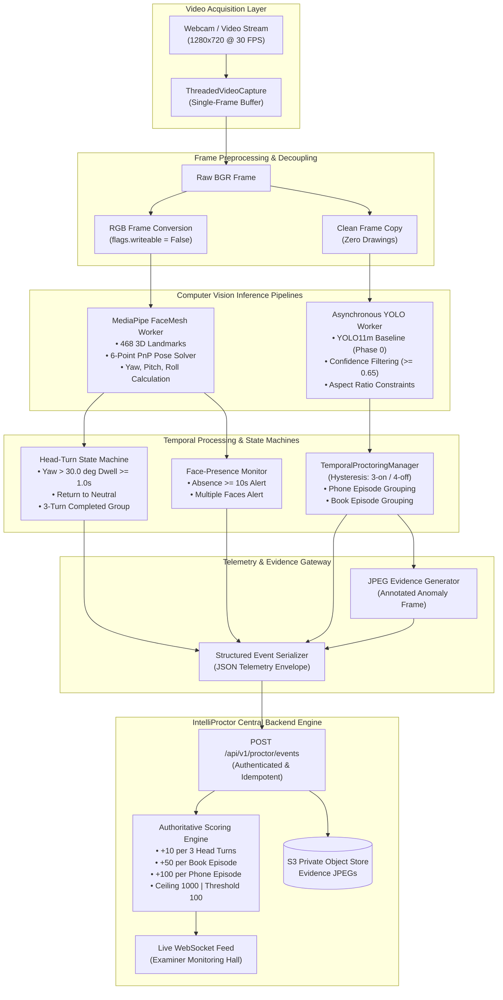
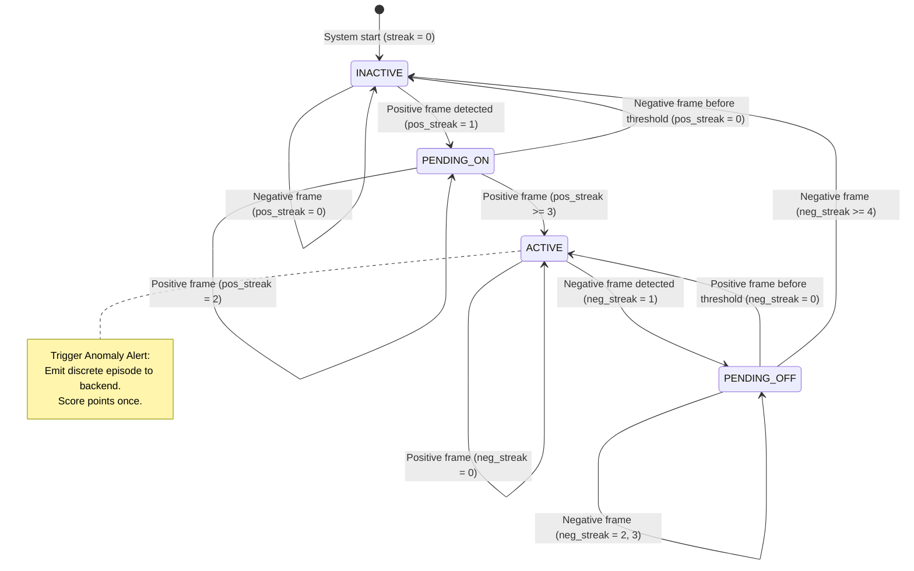
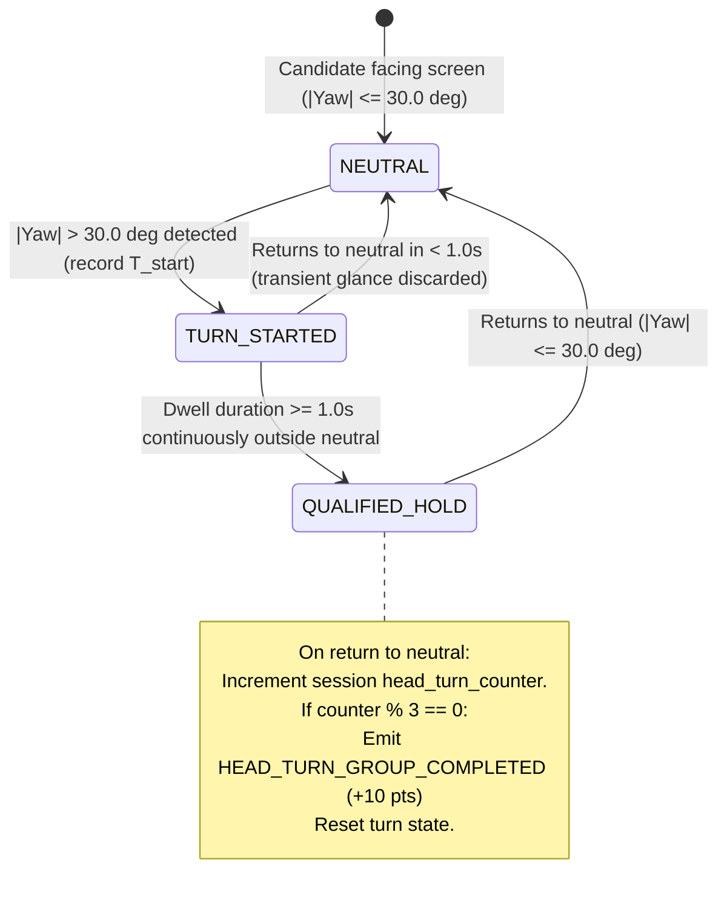

# IntelliProctor — Master Computer Vision & Model Architecture Specification

> **Document Version**: 1.0.0  
> **Repository Root**: [`c:\Users\tanis\IntelliProctor`](file:///c:/Users/tanis/IntelliProctor)  
> **System Architecture Reference**: Root [`README.md`](file:///c:/Users/tanis/IntelliProctor/README.md)  
> **Companion Specifications**: [`BACKEND_ARCHITECTURE.md`](file:///c:/Users/tanis/IntelliProctor/BACKEND_ARCHITECTURE.md) & [`FRONTEND_ARCHITECTURE.md`](file:///c:/Users/tanis/IntelliProctor/FRONTEND_ARCHITECTURE.md)  
> **Audit Companions**: [`MODEL_CURRENT_STATE.md`](file:///c:/Users/tanis/IntelliProctor/MODEL_CURRENT_STATE.md), [`BACKEND_CURRENT_STATE.md`](file:///c:/Users/tanis/IntelliProctor/BACKEND_CURRENT_STATE.md), & [`FRONTEND_CURRENT_STATE.md`](file:///c:/Users/tanis/IntelliProctor/FRONTEND_CURRENT_STATE.md)  
> **Status**: **AUTHORITATIVE TARGET SPECIFICATION** (Defines computer-vision pipeline, YOLO detection, MediaPipe head-pose analysis, telemetry streaming, examination modes, and integration boundaries).

---

## Table of Contents

1. [Purpose & Architectural Authority](#1-purpose--architectural-authority)
2. [Overall Computer-Vision Architecture](#2-overall-computer-vision-architecture)
   - [2.1 Subsystem Decomposition](#21-subsystem-decomposition)
   - [2.2 CV Component & Pipeline Diagram](#22-cv-component--pipeline-diagram)
   - [2.3 Threading & Decoupled Execution Model](#23-threading--decoupled-execution-model)
3. [Object Detection: Prohibited Objects versus Allowed Objects](#3-object-detection-prohibited-objects-versus-allowed-objects)
   - [3.1 Prohibited Target Classes](#31-prohibited-target-classes)
   - [3.2 Allowed and Irrelevant Objects](#32-allowed-and-irrelevant-objects)
   - [3.3 Unknown, Ambiguous, and Low-Confidence Detections](#33-unknown-ambiguous-and-low-confidence-detections)
4. [YOLO Inference Architecture](#4-yolo-inference-architecture)
   - [4.1 Target Inference Lifecycle](#41-target-inference-lifecycle)
   - [4.2 Per-Frame Predictions versus Event-Level Episodes](#42-per-frame-predictions-versus-event-level-episodes)
   - [4.3 Temporal Hysteresis State Machine](#43-temporal-hysteresis-state-machine)
5. [MediaPipe Facial-Landmark & Head-Pose Architecture](#5-mediapipe-facial-landmark--head-pose-architecture)
   - [5.1 3D Perspective-n-Point Pose Estimation](#51-3d-perspective-n-point-pose-estimation)
   - [5.2 Neutral Range Thresholds](#52-neutral-range-thresholds)
   - [5.3 Qualifying Sideways Head-Turn State Machine](#53-qualifying-sideways-head-turn-state-machine)
   - [5.4 Separating Physical Pose from Intentional Misconduct](#54-separating-physical-pose-from-intentional-misconduct)
6. [Required Backend Scoring Interface](#6-required-backend-scoring-interface)
   - [6.1 Mandatory Point Weights & Ceiling Enforcement](#61-mandatory-point-weights--ceiling-enforcement)
   - [6.2 Unassigned Signals: Tab Switching, Face Presence, & Posture](#62-unassigned-signals-tab-switching-face-presence--posture)
   - [6.3 Human Review & Evidence Immutability](#63-human-review--evidence-immutability)
7. [Model Parameters & Configuration Strategy](#7-model-parameters--configuration-strategy)
   - [7.1 YOLO Inference Parameters](#71-yolo-inference-parameters)
   - [7.2 Confidence & NMS Threshold Calibration](#72-confidence--nms-threshold-calibration)
   - [7.3 Temporal, Debounce, & Cooldown Parameters](#73-temporal-debounce--cooldown-parameters)
   - [7.4 Resource & Latency Optimization](#74-resource--latency-optimization)
8. [Model Evaluation & Acceptance Criteria](#8-model-evaluation--acceptance-criteria)
   - [8.1 Class-Specific Metric Gates](#81-class-specific-metric-gates)
   - [8.2 Negative Benchmark False-Positive Tolerance](#82-negative-benchmark-false-positive-tolerance)
   - [8.3 Four Levels of System Evaluation](#83-four-levels-of-system-evaluation)
9. [Production Model, Checkpoints, & Phase Management](#9-production-model-checkpoints--phase-management)
   - [9.1 Active Production Checkpoint (`phase0`)](#91-active-production-checkpoint-phase0)
   - [9.2 Experimental Checkpoint Audit (`phase2_gpu`)](#92-experimental-checkpoint-audit-phase2_gpu)
   - [9.3 Future Dataset Iteration 2 (`Dataset_it2`) Roadmap](#93-future-dataset-iteration-2-dataset_it2-roadmap)
   - [9.4 Deterministic Phase Fallback Rules](#94-deterministic-phase-fallback-rules)
10. [Frontend-Visible Behavior in Each Examination Mode](#10-frontend-visible-behavior-in-each-examination-mode)
    - [10.1 Mode A: Official Examination (Passkey Join)](#101-mode-a-official-examination-passkey-join)
    - [10.2 Mode B: Random / Practice Test (Educational Diagnostic Mode)](#102-mode-b-random--practice-test-educational-diagnostic-mode)
    - [10.3 Mode C: Examiner Post-Examination Forensic Review](#103-mode-c-examiner-post-examination-forensic-review)
    - [10.4 Mode D: Missing Model or Hardware Processing Failure](#104-mode-d-missing-model-or-hardware-processing-failure)
11. [Model-to-Backend Integration Contract](#11-model-to-backend-integration-contract)
    - [11.1 Telemetry Payload Schema](#111-telemetry-payload-schema)
    - [11.2 Ingestion Reliability & Idempotency](#112-ingestion-reliability--idempotency)
    - [11.3 Model Versioning & Provenance Metadata](#113-model-versioning--provenance-metadata)
12. [Evidence Capture & Screenshot Persistence](#12-evidence-capture--screenshot-persistence)
    - [12.1 Six-Stage Evidence Progression](#121-six-stage-evidence-progression)
    - [12.2 Event-Triggered JPEG Capture](#122-event-triggered-jpeg-capture)
    - [12.3 Pre-Signed S3 Retrieval & Candidate Access Boundaries](#123-pre-signed-s3-retrieval--candidate-access-boundaries)
13. [Dataset & Training Recommendations](#13-dataset--training-recommendations)
    - [13.1 Negative Supervision Strategy](#131-negative-supervision-strategy)
    - [13.2 Environmental & Demographic Diversity](#132-environmental--demographic-diversity)
    - [13.3 Data Leakage Prevention](#133-data-leakage-prevention)
14. [Testing & Quality Assurance Criteria](#14-testing--quality-assurance-criteria)
15. [Mandatory Guidance for Future Model Engineers](#15-mandatory-guidance-for-future-model-engineers)

---

## 1. Purpose & Architectural Authority

This document defines the **authoritative target computer-vision and machine-learning architecture for IntelliProctor**.

It provides the complete technical specification for prohibited object detection (YOLO), facial-landmark tracking and 3D head-pose estimation (MediaPipe FaceMesh), face-presence monitoring, temporal filtering, telemetry generation, and model lifecycle management.

All future development, model fine-tuning, threshold calibration, and pipeline integration must strictly adhere to the standards set forth in this document alongside the root [`README.md`](file:///c:/Users/tanis/IntelliProctor/README.md), [`BACKEND_ARCHITECTURE.md`](file:///c:/Users/tanis/IntelliProctor/BACKEND_ARCHITECTURE.md), and [`FRONTEND_ARCHITECTURE.md`](file:///c:/Users/tanis/IntelliProctor/FRONTEND_ARCHITECTURE.md).

> [!IMPORTANT]
> **Specification vs. Audit**: This document defines the **target computer-vision architecture**. For a factual inventory of existing model files, scripts, and integration gaps, consult the companion audit document [`MODEL_CURRENT_STATE.md`](file:///c:/Users/tanis/IntelliProctor/MODEL_CURRENT_STATE.md).

---

## 2. Overall Computer-Vision Architecture

### 2.1 Subsystem Decomposition

The IntelliProctor computer-vision architecture is decomposed into six coordinated, loosely coupled subsystems:

1. **Object Detection Subsystem (YOLO)**: Detects prohibited items (cell phones, books/notes) in examination video frames using deep convolutional/attention feature backbones. Applies class-specific confidence thresholds, aspect ratio filters, and bounding box geometric constraints.
2. **Facial-Landmark & Head-Pose Subsystem (MediaPipe)**: Extracts 468+ 3D facial landmarks from video frames and executes Perspective-n-Point (`solvePnP`) pose estimation to track candidate head orientation (yaw, pitch, roll) relative to the optical axis of the webcam.
3. **Face-Presence Subsystem**: Monitors candidate presence and enforces integrity checks: candidate absence ($\ge 10\text{ seconds}$), single face present (nominal), or multiple faces detected.
4. **Video Processing Subsystem (OpenCV)**: Manages camera acquisition, frame color conversion, clean-frame copying (preventing overlay confounds), landmark drawing, and JPEG evidence encoding.
5. **Browser Visibility Subsystem**: Tracks browser tab switches and window blur events via the HTML5 Page Visibility API. This is an independent DOM observation stream that does **not** use computer vision.
6. **Backend Scoring & Telemetry Ingestion Subsystem**: Ingests structured observation events, aggregates temporal episodes, applies the mandatory scoring rules ($0 \le S \le 1000$), enforces the suspicious threshold ($S \ge 100$), and coordinates S3 evidence persistence.

### 2.2 CV Component & Pipeline Diagram



### 2.3 Threading & Decoupled Execution Model

To prevent inference compute spikes from degrading webcam capture frame rates, IntelliProctor enforces a decoupled multithreaded architecture:
- **WebcamCaptureStream Thread**: Continuously queries the hardware device via DirectShow (Windows) or V4L2 (Linux) with `CAP_PROP_BUFFERSIZE = 1`. Always delivers the freshest available frame with zero buffer lag.
- **YOLOInferenceWorker Thread**: Runs in a background daemon thread. Drains clean frames from a single-item work queue, executes deep inference on the GPU/CPU, and atomically updates a thread-safe `DetectionState` container.
- **Main Processing & Display Thread**: Executes lightweight MediaPipe landmark tracking on every camera frame, reads the latest available YOLO detection results from `DetectionState` (discarding results older than the $1.5\text{ s}$ TTL to prevent ghost boxes), updates temporal filters, and renders overlays.
- **Isolation Principle**: Bounding boxes and landmark wireframes are drawn **exclusively** on display frame copies. The frame submitted to YOLO is an unmodified `clean_frame = frame.copy()` captured before any drawing operations, eliminating MediaPipe wireframe overlay confounds.

---

## 3. Object Detection: Prohibited Objects versus Allowed Objects

### 3.1 Prohibited Target Classes

IntelliProctor's active production object detector focuses strictly on two primary prohibited target classes:

```
+---------------------------------------------------------------------------------------------------+
|                                  PROHIBITED TARGET CLASSES                                        |
+-------------------+-----------------+---------------+-------------------+-------------------------+
| Canonical Class   | Model Class ID  | Target Aspect | Min. Confidence   | Target Backend Scoring  |
| Name              | (COCO / Phase0) | Ratio Range   | Threshold         | Policy Impact           |
+-------------------+-----------------+---------------+-------------------+-------------------------+
| cell phone        | 67              | [1.15, 2.90]  | 0.65              | +100 points per episode |
| book              | 73              | [0.80, 2.50]  | 0.65              | +50 points per episode  |
+-------------------+-----------------+---------------+-------------------+-------------------------+
```

#### A. Cell Phone (`cell phone`, COCO ID 67)
- **Positive Detection Definition**: A handheld mobile smartphone or cellular device visible within the candidate's workspace, held in hand, resting on the desk, or positioned near the monitor.
- **Geometric Aspect Ratio**: $1.15 \le \text{Aspect Ratio} \le 2.90$ (where $\text{Aspect Ratio} = \frac{\max(\text{width}, \text{height})}{\min(\text{width}, \text{height})}$). Rejects extreme square or ultra-thin slivers.
- **Size Threshold**: Minimum short side $\ge 12\text{ pixels}$.
- **Scoring Impact**: Each accepted distinct phone-detection episode adds **+100 points** on the backend, immediately classifying an otherwise clean candidate as Suspicious ($S \ge 100$).

#### B. Book / Prohibited Notes (`book`, COCO ID 73)
- **Positive Detection Definition**: Physical printed books, open textbooks, bound notebooks, or paper study materials present within the camera's field of view.
- **Geometric Aspect Ratio**: $0.80 \le \text{Aspect Ratio} \le 2.50$. Rejects elongated thin cables, pen shafts, and horizontal table borders.
- **Size Threshold**: Minimum short side $\ge 12\text{ pixels}$.
- **Scoring Impact**: Each accepted distinct book-detection episode adds **+50 points** on the backend. Two distinct book episodes accumulate 100 points, crossing the suspicious threshold.

### 3.2 Allowed and Irrelevant Objects

In an online examination, a wide variety of non-prohibited desk items naturally appear within the webcam frame. The model must **never** treat ordinary objects as cheating signals:

```
+---------------------------------------------------------------------------------------------------+
|                                  ALLOWED DESK & STUDY OBJECTS                                     |
+-------------------+-------------------------------------------+-----------------------------------+
| Item Category     | Visual Appearance / Common Confound       | Required Model Handling           |
+-------------------+-------------------------------------------+-----------------------------------+
| Pens & Pencils    | Thin cylindrical sticks; held in hand     | MUST NOT trigger book or phone    |
| Water Bottles     | Cylindrical transparent/colored plastic   | MUST NOT trigger book or phone    |
| Smartwatches      | Wrist-mounted small digital displays      | Screen aspect filter suppresses   |
| Eyeglasses        | Wireframe/plastic frames on candidate face| MediaPipe mesh ignores glasses    |
| Desk Chairs       | High-back mesh/leather office chairs      | Background class; zero detections |
| Computer Monitors | Secondary displays, laptop hinges         | Book filter suppresses keyboard   |
| Hands & Fingers   | Pointing, resting chin, typing            | Clean negative supervision        |
+-------------------+-------------------------------------------+-----------------------------------+
```

#### Distinguishing Vocabulary from Policy
- **Model Vocabulary Boundary**: The YOLO model possesses a fixed class vocabulary. Objects not contained within the active training classes (e.g., pens, water bottles, calculators) will not produce named detections.
- **Risk of Misclassification**: Visually similar objects may erroneously trigger a prohibited class (e.g., a dark rectangular calculator misclassified as a `cell phone`, or an open laptop keyboard misclassified as a `book`).
- **Required Mitigation**: Future dataset expansion must explicitly include hard-negative background supervision (images containing laptops, smartwatches, calculators, and water bottles labeled with 0 bounding boxes) rather than relying solely on confidence tuning.

### 3.3 Unknown, Ambiguous, and Low-Confidence Detections

When an object in the video frame produces an ambiguous model response:
1. **Confidence Below Threshold ($\text{conf} < 0.65$)**: The prediction is discarded and not submitted as an anomaly. It may be captured in internal debug logs, but it must **never** trigger alarms or alter suspicion scores.
2. **Aspect Ratio Violation**: If an object is classified as `cell phone` but has an aspect ratio of $3.5$ (e.g., a pencil or ruler), it is rejected at the post-processing filter stage.
3. **Occluded Objects**: A phone partially hidden under a hand or paper is only flagged if the visible region produces a bounding box meeting both confidence ($\ge 0.65$) and aspect ratio criteria.
4. **No Arbitrary Guessing**: The system does not attempt to "guess" prohibited intent. If an object cannot be verified with high statistical confidence, the system presumes candidate innocence.

---

## 4. YOLO Inference Architecture

### 4.1 Target Inference Lifecycle

The complete execution lifecycle for object detection consists of 14 deterministic stages:

```
[1. Select Production Checkpoint]  models/pretrained/yolo11m.pt (Phase 0 Baseline)
              │
              ▼
[2. Process Initialization]        Load weights once into memory; configure device (GPU/CPU)
              │
              ▼
[3. Acquire Video Frame]           WebcamCaptureStream fetches freshest uncompressed frame
              │
              ▼
[4. Fork Clean Frame Copy]         clean_frame = frame.copy() (Isolated from drawing layers)
              │
              ▼
[5. Input Preprocessing]           Letterbox resize to 1280x1280; normalize pixel values to [0.0, 1.0]
              │
              ▼
[6. Neural Forward Pass]           Execute YOLO11m backbone, neck, and head convolutions
              │
              ▼
[7. NMS & Box Decoding]            Apply Non-Maximum Suppression (IoU >= 0.45) to eliminate duplicates
              │
              ▼
[8. Class Mapping & Filtering]     Filter by TARGET_CLASSES (COCO 67: phone, 73: book)
              │
              ▼
[9. Confidence Filtering]          Reject boxes where conf < cls_conf_threshold (0.65)
              │
              ▼
[10. Geometric Aspect Filtering]   Enforce phone [1.15, 2.90] and book [0.80, 2.50] aspect bounds
              │
              ▼
[11. Size Threshold Filtering]     Reject detections with min(w, h) < 12 pixels
              │
              ▼
[12. Temporal Hysteresis Update]   Feed positive hit into TemporalProctoringManager (3-on/4-off)
              │
              ▼
[13. Discrete Episode Ingestion]   If hysteresis triggers new episode, emit structured event to backend
              │
              ▼
[14. Safe Resource Teardown]       Release GPU VRAM, OpenCV handles, and worker threads on session end
```

### 4.2 Per-Frame Predictions versus Event-Level Episodes

A fundamental design error in naive proctoring systems is equating raw frame predictions with cheating events. 
- At 30 FPS, a candidate holding a phone for 10 seconds generates 300 positive inference frames.
- If each frame were scored as a cheating event (+100 points), the candidate's score would instantaneously hit the 1000-point ceiling ($300 \times 100 = 30,000 \to 1000$).
- **Architectural Boundary**: IntelliProctor strictly enforces the distinction between:
  1. **Raw Frame Prediction**: A transient model output on frame #4012 (conf=0.82).
  2. **Temporally Smoothed State**: The hysteresis filter confirms object presence after 3 consecutive frames.
  3. **Detection Episode**: The continuous period from object appearance to disappearance.
  4. **Score-Affecting Event**: Exactly **one** backend scoring transaction (+100) dispatched per discrete episode.

### 4.3 Temporal Hysteresis State Machine

To prevent alert flickering and filter out transient false alarms (e.g., a candidate quickly scratching their face with a dark pen), object detections pass through a stateful hysteresis state machine ([`temporal_filter.py`](file:///c:/Users/tanis/IntelliProctor/temporal_filter.py)):



- **Activation Threshold (`on_threshold = 3`)**: Requires 3 consecutive inference frames with confirmed detection before an anomaly alert is raised.
- **Deactivation Threshold (`off_threshold = 4`)**: Requires 4 consecutive clean frames before the alert is cleared, preventing jitter when objects are briefly occluded.

---

## 5. MediaPipe Facial-Landmark & Head-Pose Architecture

### 5.1 3D Perspective-n-Point Pose Estimation

IntelliProctor tracks head orientation in metric 3D space using MediaPipe FaceMesh combined with OpenCV's iterative Perspective-n-Point solver (`cv2.solvePnP`):

#### Landmark Subset (6 Feature Points)
Out of 468 facial mesh landmarks, 6 anatomically rigid points are tracked:
1. **Landmark 1**: Nose tip
2. **Landmark 152**: Chin base
3. **Landmark 33**: Left eye outer corner
4. **Landmark 263**: Right eye outer corner
5. **Landmark 61**: Left mouth corner
6. **Landmark 287**: Right mouth corner

#### Generic 3D Anatomical Reference Model
These 2D coordinates are matched against a generic 3D human head model (metric millimeters):
```python
GENERIC_FACE_3D = np.array([
    [0.0, 0.0, 0.0],          # Nose tip
    [0.0, -330.0, -65.0],     # Chin
    [-225.0, 170.0, -135.0],  # Left eye outer corner
    [225.0, 170.0, -135.0],   # Right eye outer corner
    [-150.0, -150.0, -125.0], # Left mouth corner
    [150.0, -150.0, -125.0]   # Right mouth corner
], dtype=np.float64)
```

#### Camera Intrinsic Matrix & Euler Decomposition
The camera matrix assumes an optical center at $(\frac{w}{2}, \frac{h}{2})$ with focal length $f = w$. The rotation vector solved via Levenberg-Marquardt optimization is converted to a $3 \times 3$ rotation matrix via Rodrigues' formula and decomposed into Euler angles:
- **Yaw ($\psi$)**: Horizontal rotation (turning head left or right).
- **Pitch ($\theta$)**: Vertical rotation (nodding head up or down).
- **Roll ($\phi$)**: In-plane tilt (tilting head toward left or right shoulder).

### 5.2 Neutral Range Thresholds

The candidate's head pose is classified as **Neutral** if all three Euler angles fall within verified bounding limits:

$$|\text{Yaw}| \le 30.0^\circ \quad \land \quad |\text{Pitch}| \le 25.0^\circ \quad \land \quad |\text{Roll}| \le 25.0^\circ$$

If any angle exceeds these bounds, the head orientation is classified as `Outside Neutral Range`.

### 5.3 Qualifying Sideways Head-Turn State Machine

To enforce the scoring requirement (**+10 points per completed group of 3 qualifying sideways turns**), the CV processing layer must implement a formal event state machine:



#### Qualification Invariants
1. **Minimum Dwell Time**: The head must remain continuously outside the neutral yaw range ($|\text{Yaw}| > 30.0^\circ$) for at least **1.0 second**. Brief natural eye saccades or rapid glances ($< 1.0\text{ s}$) do not qualify.
2. **Return to Neutral**: A qualifying turn is registered only after the candidate returns to the neutral position ($|\text{Yaw}| \le 30.0^\circ$). Holding the head sideways indefinitely counts as a single ongoing event, not multiple turns.
3. **Cooldown Period**: A mandatory 2.0-second cooldown is enforced following a turn before a new qualifying turn can begin, preventing jitter at the $30^\circ$ boundary from double-counting.

### 5.4 Separating Physical Pose from Intentional Misconduct

The computer-vision layer must maintain strict neutrality in terminology:
- An observation of $\text{Yaw} = 42^\circ$ is a **Head Pose Observation**, not "Cheating".
- Candidates may turn their head due to physical stiffness, looking at scratch paper, or external noise.
- Automated proctoring records the physical metric; only the cumulative backend policy and human examiner review determine whether misconduct occurred.

---

## 6. Required Backend Scoring Interface

### 6.1 Mandatory Point Weights & Ceiling Enforcement

All computer-vision observations feed into the centralized backend scoring engine. The vision layer emits structured telemetry; the backend executes the following non-negotiable scoring rules:

| Accepted Qualifying Event | Authoritative Backend Weight | Cumulative Ceiling Impact | Suspicious Threshold Impact |
|---|:---:|---|---|
| **Completed Group of 3 Sideways Head Turns** | **+10 points** | Monotonically added up to 1000 | Reaches Suspicious at 30 turns |
| **Distinct Phone Detection Episode** | **+100 points** | Monotonically added up to 1000 | **Immediately Suspicious** ($S = 100$) |
| **Distinct Book Detection Episode** | **+50 points** | Monotonically added up to 1000 | Reaches Suspicious at 2 episodes |
| **Maximum Score Ceiling** | **1000 points** | Hard cap ($\min(1000, S)$) | Score never exceeds 1000 |
| **Suspicious Classification** | **Threshold: 100**| Evaluated on every ledger transaction| $\text{Suspicious} \iff S \ge 100$ |

### 6.2 Unassigned Signals: Tab Switching, Face Presence, & Posture

Several vital proctoring signals captured by the platform have **NO assigned numerical score weight**:
- **Browser Tab Switching (`TAB_BLUR` / `TAB_FOCUS`)**: Logged with dwell duration; score impact: **+0**.
- **Candidate Absence (`CANDIDATE_ABSENT`, $\ge 10\text{ s}$)**: Logged with timestamps; score impact: **+0**.
- **Multiple Faces (`MULTIPLE_FACES`)**: Logged with face count; score impact: **+0**.
- **Pitch / Roll Deviations**: Looking up, down, or tilting head; score impact: **+0**.

> [!CAUTION]
> **No Unapproved Weights**: Future engineers must **never** assign arbitrary numerical points to tab switches, candidate absence, or multiple faces without an explicit, approved policy amendment. These events must be persisted as non-numeric flags in the event ledger.

### 6.3 Human Review & Evidence Immutability

Examiners possess full administrative authority to review flagged events and dismiss false positives:
- When an examiner dismisses an event, the backend records an entry in `examiner_reviews` and marks `review_status = 'DISMISSED'`.
- The raw computer-vision prediction, bounding box, confidence value, and JPEG screenshot are **never deleted or altered**.
- In accordance with [`BACKEND_ARCHITECTURE.md`](file:///c:/Users/tanis/IntelliProctor/BACKEND_ARCHITECTURE.md), the automated score ledger remains preserved, while the human-reviewed status is presented alongside it.

---

## 7. Model Parameters & Configuration Strategy

### 7.1 YOLO Inference Parameters

The table below defines the required production configuration parameters for the YOLO inference engine:

```
+-----------------------------------+-----------------------------------+-----------------------------------+
| Parameter Name                    | Production Setting (Phase 0)      | Selection Rationale               |
+-----------------------------------+-----------------------------------+-----------------------------------+
| Active Checkpoint Path            | models/pretrained/yolo11m.pt      | Verified baseline; 0% negative FPR|
| Model Architecture                | YOLO11 Medium (Ultralytics)       | Optimal balance of mAP vs latency |
| Inference Image Size (`imgsz`)    | 1280x1280 (Letterbox)             | High resolution for small phones  |
| Global Confidence Threshold       | 0.65                              | Suppresses background clutter     |
| NMS IoU Threshold                 | 0.45                              | Eliminates duplicate detections   |
| Maximum Detections per Frame      | 10                                | Prevents VRAM exhaustion          |
| Execution Device                  | Auto-detect (GPU: 0 / CPU fallback)| Low latency when GPU is available |
| Precision Mode                    | FP32 (CPU) / FP16 (CUDA/AMP)      | 2x inference speedup on Tensor Cores|
| Minimum Object Dimension          | 12 pixels                         | Discards sub-pixel noise          |
| Phone Aspect Ratio Window         | [1.15, 2.90]                      | Matches real smartphone geometry  |
| Book Aspect Ratio Window          | [0.80, 2.50]                      | Matches bound notebooks/textbooks |
+-----------------------------------+-----------------------------------+-----------------------------------+
```

### 7.2 Confidence & NMS Threshold Calibration

Threshold selection represents a fundamental trade-off between **Recall** and **False Positive Rate (FPR)**:
- **Low Confidence Thresholds ($\text{conf} < 0.50$)**: As proven in [`reports/ml/PHASE3_POST_PROCESSING_REVIEW.md`](file:///c:/Users/tanis/IntelliProctor/reports/ml/PHASE3_POST_PROCESSING_REVIEW.md), lowering confidence to $0.10$ achieves 40% book recall but explodes the false positive rate to **86.4%** across non-prohibited desk objects.
- **High Confidence Thresholds ($\text{conf} > 0.80$)**: Drastically reduces false alarms but causes the model to miss phones held at slight angles.
- **Production Operating Point ($\text{conf} = 0.65$)**: The $0.65$ threshold ensures that only detections with strong feature activations are accepted, maintaining a clean examination environment.

### 7.3 Temporal, Debounce, & Cooldown Parameters

- **YOLO Temporal Hysteresis**:
  - `on_threshold = 3`: 3 consecutive detection frames required to activate.
  - `off_threshold = 4`: 4 consecutive negative frames required to clear.
- **No-Face Absence Timer**:
  - `NO_FACE_ALERT_SECONDS = 10`: Candidate must be completely absent for 10 continuous seconds before triggering `CANDIDATE_ABSENT`.
- **Head-Turn State Machine**:
  - Minimum dwell time outside neutral: $1.0\text{ second}$.
  - Return to neutral threshold: $|\text{Yaw}| \le 30.0^\circ$.
  - Post-turn event cooldown: $2.0\text{ seconds}$.

### 7.4 Resource & Latency Optimization

- **CPU Benchmark**: On modern multi-core x86 CPUs, YOLO11m (1280x1280) exhibits a median latency of **864.01 ms** (~1.16 FPS).
- **GPU Benchmark**: On dedicated NVIDIA laptop/desktop GPUs (e.g., RTX 4050), median inference latency drops to **18–25 ms** (~40–55 FPS).
- **Decoupled Architecture Requirement**: Because CPU inference runs at ~1.16 FPS, the capture thread must remain decoupled so that MediaPipe FaceMesh (which executes at 30+ FPS on CPU) can provide smooth real-time video feedback without stuttering.

---

## 8. Model Evaluation & Acceptance Criteria

### 8.1 Class-Specific Metric Gates

Future model iterations (such as Training Iteration 2) must meet the following quantitative metric gates before being approved for production deployment:

```
+-----------------------------------+-------------------+-------------------+-------------------+
| Metric / Criterion                | Pre-Trained Base  | Iteration 1 Result| Production Gate   |
|                                   | (Phase 0)         | (Phase 2 GPU)     | (Mandatory Exit)  |
+-----------------------------------+-------------------+-------------------+-------------------+
| Phone Filtered Recall             | 17.6% (3/17)      | 11.8% (2/17)      | >= 50.0% (9/17)   |
| Book Filtered Recall              | 0.0% (0/15)       | 0.0% (0/15)       | >= 40.0% (6/15)   |
| Negative Benchmark FPR (140 imgs) | 13.6% (19/140)    | 47.9% (67/140)    | <= 5.0% (7/140)   |
| Baseline PASS Regressions         | 0                 | 2 regressions     | 0 (Zero allowed)  |
| Median CPU Inference Latency      | 911.25 ms         | 864.01 ms         | <= 911.25 ms      |
+-----------------------------------+-------------------+-------------------+-------------------+
```

### 8.2 Negative Benchmark False-Positive Tolerance

- The held-out Negative Benchmark comprises **140 diverse desk images** across 9 non-prohibited categories: Laptops (20), Tablets (20), Smartwatches (15), Calculators (15), Notebooks (15), Headphones (15), Water Bottles (10), Pens (10), and Other desk clutter (20).
- An acceptable production model must achieve an overall False Positive Rate of **$\le 5.0\%$** ($\le 7$ false alarms across all 140 images).

### 8.3 Four Levels of System Evaluation

Model evaluation must distinguish between four separate operational levels:
1. **Frame-Level Model Metrics**: mAP50, mAP50-95, precision, recall on static images.
2. **Temporal Event Metrics**: Episode detection accuracy, hysteresis stability, event-level false positive rate.
3. **End-to-End Telemetry Transport**: Event serialization, network transmission, backend ingestion latency.
4. **Application-Level Experience**: Integrity score accuracy, live monitoring responsiveness, examiner report fidelity.

---

## 9. Production Model, Checkpoints, & Phase Management

### 9.1 Active Production Checkpoint (`phase0`)
- **Active Model File**: [`models/pretrained/yolo11m.pt`](file:///c:/Users/tanis/IntelliProctor/models/pretrained/yolo11m.pt) (40.5 MB).
- **Class Vocabulary**: Standard COCO 80-class mapping. Target indices: Class 67 (`cell phone`), Class 73 (`book`).
- **Status**: **ACTIVE PRODUCTION BASELINE**. Achieves stable execution, zero false alarms on raw local backgrounds, and passes all integration tests.

### 9.2 Experimental Checkpoint Audit (`phase2_gpu`)
- **Experimental Model File**: [`models/trained/intelliproctor_phase1_iter1/best.pt`](file:///c:/Users/tanis/IntelliProctor/models/trained/intelliproctor_phase1_iter1/best.pt).
- **Classes**: Custom 2-class mapping (`0: phone`, `1: book_notebook`).
- **Deficiency Audit**: As established in [`reports/ml/TRAINING_ITERATION_1_REPORT.md`](file:///c:/Users/tanis/IntelliProctor/reports/ml/TRAINING_ITERATION_1_REPORT.md), this model suffered catastrophic domain overfitting due to training on only 21 positive images per class with zero negative supervision. On the 140-image negative benchmark, its false positive rate exploded to **47.9%**.
- **Deployment Status**: **DO NOT DEPLOY ITERATION 1 WEIGHTS**. This checkpoint is quarantined for historical evaluation only.

### 9.3 Future Dataset Iteration 2 (`Dataset_it2`) Roadmap
- **Dataset Asset**: [`Dataset_it2`](file:///c:/Users/tanis/IntelliProctor/Dataset_it2) (Consolidated October 2026).
- **Inventory**: 377 total images:
  - 114 positive phone images (117 bounding boxes).
  - 111 positive book_notebook images (115 bounding boxes).
  - **152 hard-negative background images** (bottles, hands, calculators, pens, smartwatches).
- **Target Role**: Ready for Phase 5 training to produce `intelliproctor_phase2_iter2/weights/best.pt`.

### 9.4 Deterministic Phase Fallback Rules

In [`video_input_analysis.py`](file:///c:/Users/tanis/IntelliProctor/video_input_analysis.py#L105-L127), phase configuration is resolved via `resolve_phase_config()`:
1. Environment variable `INTELLIPROCTOR_PHASE` or CLI flag `--phase` is checked.
2. If an unknown phase is requested, or if the weights file for a requested phase does not exist on disk, the system logs a warning and **deterministically falls back to `phase0`**.

---

## 10. Frontend-Visible Behavior in Each Examination Mode

The user experience and visual diagnostics must be strictly customized based on the examination context and user role.

### 10.1 Mode A: Official Examination (Passkey Join)

#### A1. Candidate Pre-Exam Verification
- Candidate enters 6-digit passkey at `/student/passkey`.
- Hardware check verifies webcam and microphone permissions.
- Candidate aligns face inside the circular positioning guide of [`IdentityVerificationModal.jsx`](file:///c:/Users/tanis/IntelliProctor/Frontend/src/components/proctor/IdentityVerificationModal.jsx) and captures a reference photograph.

#### A2. Active Examination — Candidate Experience
- **What the Candidate Sees**:
  - Examination questions, options, palette, and remaining countdown timer.
  - A small, clean local webcam preview in the upper-right corner.
  - General status indicator: `Camera Active` (Green pill).
  - High-level non-alarming operational notices (e.g., *"Lighting is low; please adjust your desk lamp"*).
- **What the Candidate MUST NOT See**:
  - **NO internal YOLO bounding boxes** or detection confidence percentages.
  - **NO MediaPipe facial landmark mesh** or contour wireframes.
  - **NO numeric head-pose values** (Yaw: 32.4°, Pitch: -12.1°).
  - **NO real-time suspicion scores** or risk meters.
  - **NO aggressive red warning toasts** with buzzer sounds (prevents candidate panic).

#### A3. Active Examination — Examiner Experience
- Examiner accesses `/admin/live-monitoring` (The Live Hall).
- Receives real-time candidate roster filtered by risk status (All / High / Medium / Low).
- Candidate cards display remote WebRTC video feeds with optional diagnostic overlays.
- Displays authoritative suspicion scores ($0 \le S \le 1000$), suspicious badges ($S \ge 100$), and real-time anomaly event timelines.

#### A4. Post-Examination Reporting
- **Candidate Report (`/student/report/:id`)**: Shows academic marks, percentage, trust score, and high-level anomaly breakdown. **Omits raw evidence screenshots and examiner notes**.
- **Examiner Report (`/admin/reports/:id`)**: Shows full forensic dossier, pre-signed screenshot links, detection confidence, head-pose angles, tab-switch log, and dismissal controls.

### 10.2 Mode B: Random / Practice Test (Educational Diagnostic Mode)

Practice examinations provide an educational, self-assessment environment where candidates learn how proctoring works:
- **Examinee Diagnostic Experience**:
  - In practice mode (`/student/practice`), the candidate **CAN view full computer-vision diagnostics**.
  - Renders live YOLO bounding boxes with class labels and confidence percentages (`cell phone 0.88`).
  - Displays real-time Euler angles (`Yaw: 12.1°  Pitch: -4.2°  Roll: 1.0°`).
  - Highlights face contours and displays head status (`Head: Neutral` vs `Head: Outside neutral range`).
  - Displays active anomaly alerts (`ALERT: Phone detected!`).
- **Reporting**: Instantaneous educational score breakdown explaining why specific behaviors triggered detection.

### 10.3 Mode C: Examiner Post-Examination Forensic Review

- Examiner opens an individual candidate's audit view at `/admin/reports/:id`.
- The interface presents a chronological event timeline.
- For each flagged anomaly:
  - Displays timestamp, event type, model confidence, and duration.
  - Renders the supporting JPEG evidence screenshot retrieved via pre-signed S3 URL.
  - Provides a "Dismiss as False Positive" button requiring an examiner justification note.
  - Dismissal updates the review status without altering original model detections or erasing evidence.

### 10.4 Mode D: Missing Model or Hardware Processing Failure

If the computer-vision process crashes, cannot open the camera, or fails to load weights:
- The system must **never** pretend that proctoring is active.
- Camera widget renders a prominent error card: `Camera Pipeline Offline: Error Loading Model Checkpoint`.
- The frontend dispatches a telemetry alert to the backend: `CV_SERVICE_UNAVAILABLE`.
- The examiner dashboard displays a warning banner: `Telemetry Paused for Candidate #102: Hardware Connection Lost`.

---

## 11. Model-to-Backend Integration Contract

### 11.1 Telemetry Payload Schema

The computer-vision worker transmits structured telemetry to the backend ingestion endpoint (`POST /api/v1/proctor/events`) using the following JSON contract:

```json
{
  "$schema": "https://json-schema.org/draft/2020-12/schema",
  "title": "CVProctoringEventPayload",
  "type": "object",
  "required": ["sessionId", "episodeId", "source", "eventType", "timestamp", "modelVersion"],
  "properties": {
    "sessionId": { "type": "string", "format": "uuid" },
    "episodeId": { "type": "string", "description": "Unique UUID for the continuous detection episode" },
    "source": { "type": "string", "enum": ["YOLO_CV", "MEDIAPIPE_HEAD_POSE", "MEDIAPIPE_FACE_COUNT"] },
    "eventType": { 
      "type": "string", 
      "enum": ["PHONE_DETECTED", "BOOK_DETECTED", "HEAD_TURN_SIDEWAYS", "CANDIDATE_ABSENT", "MULTIPLE_FACES"] 
    },
    "timestamp": { "type": "string", "format": "date-time" },
    "durationMs": { "type": "integer", "minimum": 0 },
    "confidence": { "type": "number", "minimum": 0.0, "maximum": 1.0 },
    "boundingBox": {
      "type": "object",
      "properties": {
        "x1": { "type": "integer" },
        "y1": { "type": "integer" },
        "x2": { "type": "integer" },
        "y2": { "type": "integer" }
      }
    },
    "headPoseAngles": {
      "type": "object",
      "properties": {
        "yaw": { "type": "number" },
        "pitch": { "type": "number" },
        "roll": { "type": "number" }
      }
    },
    "evidenceBase64": { "type": "string", "description": "JPEG encoded screenshot bytes" },
    "modelVersion": { "type": "string", "example": "yolo11m-phase0-baseline" }
  }
}
```

### 11.2 Ingestion Reliability & Idempotency
- **Idempotency Key**: Generated as `SHA256(sessionId + eventType + episodeId)`. Duplicate network submissions return the existing event record with zero duplicate scoring.
- **Clock Drift**: Telemetry timestamps diverging by $> 30\text{ seconds}$ from server time are flagged with `clock_skewed = true`.

### 11.3 Model Versioning & Provenance Metadata
Every persisted proctoring event stores the `model_version` tag (e.g., `yolo11m-phase0-baseline`). This ensures forensic reproducibility: examiners reviewing reports months later can identify the exact model checkpoint that produced the detection.

---

## 12. Evidence Capture & Screenshot Persistence

### 12.1 Six-Stage Evidence Progression

```
[Stage 1: Anomaly Confirmed]      YOLO / MediaPipe temporal state machine triggers confirmed alert
              │
              ▼
[Stage 2: Frame Selection]        Clean frame containing peak confidence detection is selected
              │
              ▼
[Stage 3: Evidence Annotation]    Bounding box, class name, confidence, and timestamp are rendered
              │
              ▼
[Stage 4: JPEG Encoding]          Encoded as JPEG (quality=85, target size 60–120 KB)
              │
              ▼
[Stage 5: Secure S3 Persistence]  Transferred to S3 bucket: s3://evidence/{exam_id}/{session_id}/{event_id}.jpg
              │
              ▼
[Stage 6: Pre-Signed Retrieval]   Backend generates 15-minute signed URL for authorized examiner review
```

### 12.2 Event-Triggered JPEG Capture
- **Selective Storage**: Screenshots are captured **strictly upon confirmed anomaly events**. Continuous video frames are never stored in the database.
- **Privacy Protection**: Anomaly evidence is retained under a strict 90-day lifecycle expiration policy.

### 12.3 Pre-Signed S3 Retrieval & Candidate Access Boundaries
- Raw evidence screenshots are stored in private, non-public S3 buckets.
- Only authorized examiners can retrieve signed image URLs via `GET /api/v1/proctor/events/:id/evidence`.
- Examinees are **never** provided access to raw evidence images during an examination.

---

## 13. Dataset & Training Recommendations

### 13.1 Negative Supervision Strategy
To resolve the catastrophic false positive rate observed in Iteration 1 (47.9% FPR), future training must enforce negative supervision:
- Include at least **150+ hard-negative images** featuring laptops, monitors, smartwatches, keyboards, calculators, and notebooks labeled with **0 bounding boxes**.
- The model must learn that open laptop screens and keyboards are non-prohibited background clutter.

### 13.2 Environmental & Demographic Diversity
- Train across diverse subjects (varied skin tones, genders, hair styles, eyeglasses).
- Train across varied lighting conditions (direct sunlight, warm indoor lamps, dim webcam lighting).
- Train across varied camera resolutions (720p, 1080p, grainy budget laptop cameras).

### 13.3 Data Leakage Prevention
- Positive and negative recordings must be grouped by **session and subject ID**.
- All images from a specific recording session must belong exclusively to either Train, Val, or Test splits. Cross-split frame bleeding must be strictly prevented.

---

## 14. Testing & Quality Assurance Criteria

Before deploying any future model checkpoint or computer-vision refactor, the pipeline must pass four test suites:

1. **Object Detection Unit Tests**:
   - Verify phone detection on positive test images.
   - Verify book detection on positive test images.
   - Verify rejection of pens, water bottles, and smartwatches.
2. **Temporal & Deduplication Tests**:
   - Verify that 30 consecutive frames of a phone detection produce exactly one discrete episode and one +100 score addition.
   - Verify that 3 qualifying sideways turns add exactly +10 points.
3. **Pipeline Integration Tests**:
   - Execute `tests/test_production_integration.py` (verify phase resolution, fallback to `phase0`, clean frame isolation).
   - Execute `tests/test_decoupled_pipeline.py` (verify `WebcamCaptureStream` and `YOLOInferenceWorker` concurrency).
4. **Metric Acceptance Gates**:
   - Achieve Phone Recall $\ge 50.0\%$, Book Recall $\ge 40.0\%$, and Negative Benchmark FPR $\le 5.0\%$.

---

## 15. Mandatory Guidance for Future Model Engineers

Future computer-vision and machine-learning engineers working on IntelliProctor must adhere to the following 18 rules:

1. **Read Core Architecture First**: Read `README.md`, `MODEL_ARCHITECTURE.md`, `MODEL_CURRENT_STATE.md`, and `BACKEND_ARCHITECTURE.md` before modifying code.
2. **Do Not Deploy Iteration 1 Weights**: The active production model is `phase0` (`models/pretrained/yolo11m.pt`). Do not deploy `intelliproctor_phase1_iter1/best.pt`.
3. **Do Not Retrain Models During Integration Tasks**: Model training is a distinct ML task requiring explicit dataset preparation.
4. **Do Not Touch Held-Out Test Data**: Held-out benchmark test sets must remain strictly untouched to preserve scientific validity.
5. **Clean Frame Inference Isolation**: Always feed an unmodified copy of the frame (`clean_frame = frame.copy()`) to YOLO. Never run inference on frames corrupted with MediaPipe drawings.
6. **The Backend Owns Suspicion Scores**: Never calculate or update suspicion scores inside Python CV scripts or frontend hooks.
7. **Enforce Exact Point Weights**: Sideways turns add +10 per group of 3; phone episodes add +100; book episodes add +50.
8. **Enforce Suspicious Threshold**: A candidate is suspicious if and only if $S \ge 100$.
9. **Enforce Score Ceiling**: Never permit cumulative candidate scores to exceed 1000 points.
10. **Deduplicate Frame Detections**: Group consecutive frames into discrete episodes using temporal hysteresis filters (3-on/4-off).
11. **Do Not Invent Scoring Weights**: Never assign arbitrary point values to tab switching, candidate absence, or multiple faces without an approved policy amendment.
12. **Keep Tab Switching Decoupled**: Tab switching is an independent browser DOM event, not a computer vision detection.
13. **Respect Examination Modes**: Never expose internal bounding boxes or MediaPipe wireframes to official examinees (Mode A). Only expose diagnostics in Practice Mode (Mode B).
14. **Enforce Aspect Ratio Constraints**: Maintain phone aspect ratio $[1.15, 2.90]$ and book aspect ratio $[0.80, 2.50]$.
15. **Use 6-Point PnP for Head Pose**: Maintain generic 3D model landmarks (1, 152, 33, 263, 61, 287) and neutral bounds ($30^\circ, 25^\circ, 25^\circ$).
16. **Evidence Must Be Event-Triggered**: Never save every video frame. Save JPEG screenshots strictly upon confirmed anomaly events.
17. **Preserve Human Review Integrity**: Examiner dismissals update review metadata; they must never delete evidence or alter raw model outputs.
18. **Update Documentation**: Update architecture and audit files whenever model checkpoints, class definitions, or thresholds change.
