# IntelliProctor — Master Architecture & Technical Reference Manual

> **System Designation**: IntelliProctor (AI-Assisted Online Examination & Proctoring Platform)  
> **Repository Root**: `C:\Users\tanis\IntelliProctor`  
> **Status**: Core Computer-Vision Pipeline Verified; React Frontend Prototype Operational; Backend API & Streaming Integration Planned  
> **Current Active CV Phase**: `phase0` (Optimized Pretrained YOLO11m Baseline + MediaPipe Face Mesh + Temporal Filter)  
> **Document Role**: Authoritative Master Architecture Specification & Long-Term Reference for Future Agents & Engineers  

---

## Table of Contents

1. [Executive Overview & Core System Philosophy](#1-executive-overview--core-system-philosophy)
2. [Current Implementation vs. Planned Architecture Matrix](#2-current-implementation-vs-planned-architecture-matrix)
3. [Repository Directory & Component Reference](#3-repository-directory--component-reference)
4. [End-to-End User Experience & Workflows](#4-end-to-end-user-experience--workflows)
   - [4.1 Landing Page & Role Selection](#41-landing-page--role-selection)
   - [4.2 Examiner: Test Creation, Question Banks, & PIN Generation](#42-examiner-test-creation-question-banks--pin-generation)
   - [4.3 Examinee: PIN Entry, Identity Verification, & System Check](#43-examinee-pin-entry-identity-verification--system-check)
   - [4.4 Virtual Examination Hall: Active Testing & Client Controls](#44-virtual-examination-hall-active-testing--client-controls)
   - [4.5 Examiner: Live Monitoring Grid & Incident Triage](#45-examiner-live-monitoring-grid--incident-triage)
   - [4.6 Examination Completion, Reporting, & Evidence Audit](#46-examination-completion-reporting--evidence-audit)
   - [4.7 Practice & Diagnostic Test Mode](#47-practice--diagnostic-test-mode)
5. [Computer Vision & Proctoring Pipeline Architecture](#5-computer-vision--proctoring-pipeline-architecture)
   - [5.1 Pipeline Topology & Real-Time Decoupling](#51-pipeline-topology--real-time-decoupling)
   - [5.2 OpenCV Webcam Acquisition (`WebcamCaptureStream`)](#52-opencv-webcam-acquisition-webcamcapturestream)
   - [5.3 MediaPipe Face Mesh & Landmarking](#53-mediapipe-face-mesh--landmarking)
   - [5.4 3D Head-Pose Estimation (`calculate_head_pose`)](#54-3d-head-pose-estimation-calculate_head_pose)
   - [5.5 Face Count & Absence Tracking](#55-face-count--absence-tracking)
   - [5.6 YOLO Object Detection Engine (`YOLOInferenceWorker`)](#56-yolo-object-detection-engine-yoloinferenceworker)
   - [5.7 Bounding Box, Aspect Ratio, & Geometric Filtering](#57-bounding-box-aspect-ratio--geometric-filtering)
   - [5.8 Multi-Frame Temporal Smoothing & Debouncing (`temporal_filter.py`)](#58-multi-frame-temporal-smoothing--debouncing-temporal_filterpy)
   - [5.9 MediaPipe Drawing Confound Isolation (Option A Clean-Buffer Fix)](#59-mediapipe-drawing-confound-isolation-option-a-clean-buffer-fix)
6. [Machine Learning Model Lifecycle & Evaluation History](#6-machine-learning-model-lifecycle--evaluation-history)
   - [6.1 Model Architecture & Checkpoint Inventory](#61-model-architecture--checkpoint-inventory)
   - [6.2 Phase 0 Baseline & Aspect-Ratio Sweep](#62-phase-0-baseline--aspect-ratio-sweep)
   - [6.3 Phase 1 / Training Iteration 1 (GPU Fine-Tuning)](#63-phase-1--training-iteration-1-gpu-fine-tuning)
   - [6.4 Training Iteration 1 Failure Analysis: Domain Shift & Overfitting](#64-training-iteration-1-failure-analysis-domain-shift--overfitting)
   - [6.5 Phase 3 Post-Processing Grid Search & Gate Verdict](#65-phase-3-post-processing-grid-search--gate-verdict)
   - [6.6 Training Iteration 2 (Dataset_it2 Grand Dataset & Augmentation)](#66-training-iteration-2-dataset_it2-grand-dataset--augmentation)
   - [6.7 Comparative Benchmark Evaluation Results](#67-comparative-benchmark-evaluation-results)
   - [6.8 Formal Model Deployment Governance Rules](#68-formal-model-deployment-governance-rules)
7. [Suspicion Scoring, Event Taxonomy, & Evidence Audit](#7-suspicion-scoring-event-taxonomy--evidence-audit)
   - [7.1 The Six-Tier Observation-to-Verdict Pipeline](#71-the-six-tier-observation-to-verdict-pipeline)
   - [7.2 Event Taxonomy & Severity Classification](#72-event-taxonomy--severity-classification)
   - [7.3 Mathematical Composite Suspicion Scoring Formulation](#73-mathematical-composite-suspicion-scoring-formulation)
   - [7.4 Evidence Packaging & Immutability Rules](#74-evidence-packaging--immutability-rules)
   - [7.5 Examiner Dismissal Workflow & Audit Preservation](#75-examiner-dismissal-workflow--audit-preservation)
8. [Frontend Architecture & Component System](#8-frontend-architecture--component-system)
   - [8.1 Technology Stack & Build Pipeline](#81-technology-stack--build-pipeline)
   - [8.2 Routing & Navigation Architecture (`AppRoutes.jsx`)](#82-routing--navigation-architecture-approutesjsx)
   - [8.3 State Management & Context Layer](#83-state-management--context-layer)
   - [8.4 Custom Hooks & UI Simulators](#84-custom-hooks--ui-simulators)
   - [8.5 Page-by-Page Technical Breakdown](#85-page-by-page-technical-breakdown)
   - [8.6 Canvas Overlay Engine (`CameraWidget.jsx`)](#86-canvas-overlay-engine-camerawidgetjsx)
9. [Target Backend & Persistence Architecture](#9-target-backend--persistence-architecture)
   - [9.1 Backend Framework & Gateway Specification](#91-backend-framework--gateway-specification)
   - [9.2 Relational Database Schema & Entities](#92-relational-database-schema--entities)
   - [9.3 Entity-Relationship Diagram (ERD)](#93-entity-relationship-diagram-erd)
   - [9.4 Storage Architecture: Reference Photos & Evidence Keyframes](#94-storage-architecture-reference-photos--evidence-keyframes)
   - [9.5 API Endpoint Specification & Contracts](#95-api-endpoint-specification--contracts)
10. [End-to-End Data Flows & Interaction Protocols](#10-end-to-end-data-flows--interaction-protocols)
    - [Flow A: Candidate Registration & Reference Photo Capture](#flow-a-candidate-registration--reference-photo-capture)
    - [Flow B: Examiner Creates & Publishes an Examination](#flow-b-examiner-creates--publishes-an-examination)
    - [Flow C: Candidate Joins via Passkey & System Diagnostics](#flow-c-candidate-joins-via-passkey--system-diagnostics)
    - [Flow D: Live Proctoring Telemetry Pipeline](#flow-d-live-proctoring-telemetry-pipeline)
    - [Flow E: Evidence Trigger, Capture, & Storage](#flow-e-evidence-trigger-capture--storage)
    - [Flow F: Examination Submission, Scoring, & Report Generation](#flow-f-examination-submission-scoring--report-generation)
    - [Flow G: Practice / Diagnostic Self-Test Session](#flow-g-practice--diagnostic-self-test-session)
    - [Flow H: Live Remote Monitoring & Flag Triage](#flow-h-live-remote-monitoring--flag-triage)
11. [Performance, Concurrency, & Video Transport Engineering](#11-performance-concurrency--video-transport-engineering)
    - [11.1 The Four Distinct Video/Data Streams](#111-the-four-distinct-videodata-streams)
    - [11.2 Latency Budgets & Framerate Decoupling](#112-latency-budgets--framerate-decoupling)
    - [11.3 Remote Video Transport Strategy (WebRTC vs. MJPEG vs. HLS)](#113-remote-video-transport-strategy-webrtc-vs-mjpeg-vs-hls)
    - [11.4 Resource Lifecycle & Clean Teardown](#114-resource-lifecycle--clean-teardown)
12. [Security, Privacy, & Examination Integrity](#12-security-privacy--examination-integrity)
    - [12.1 Authentication & Role-Based Access Control (RBAC)](#121-authentication--role-based-access-control-rbac)
    - [12.2 Exam Passkey Protection & Anti-Brute-Force](#122-exam-passkey-protection--anti-brute-force)
    - [12.3 Multi-Tenant Candidate Session Isolation](#123-multi-tenant-candidate-session-isolation)
    - [12.4 Answer Key & Question Protection](#124-answer-key--question-protection)
    - [12.5 Video, Photograph, & Evidence Data Privacy (GDPR/FERPA)](#125-video-photograph--evidence-data-privacy-gdprferpa)
13. [Development Environment, Operations, & Verification Guide](#13-development-environment-operations--verification-guide)
    - [13.1 Prerequisites & System Requirements](#131-prerequisites--system-requirements)
    - [13.2 Python CV & ML Environment Setup](#132-python-cv--ml-environment-setup)
    - [13.3 Frontend Development Setup](#133-frontend-development-setup)
    - [13.4 Running the Computer-Vision Pipeline](#134-running-the-computer-vision-pipeline)
    - [13.5 Automated Test Suites Execution](#135-automated-test-suites-execution)
    - [13.6 Model Training & Evaluation Operations](#136-model-training--evaluation-operations)
    - [13.7 Operational Troubleshooting & Known Pitfalls](#137-operational-troubleshooting--known-pitfalls)
14. [Development Rules for Future Coding Agents](#14-development-rules-for-future-coding-agents)

---

## 1. Executive Overview & Core System Philosophy

**IntelliProctor** is a distributed, AI-assisted examination administration and integrity verification platform. It unites an interactive examination portal with an asynchronous, multi-modal computer-vision proctoring engine.

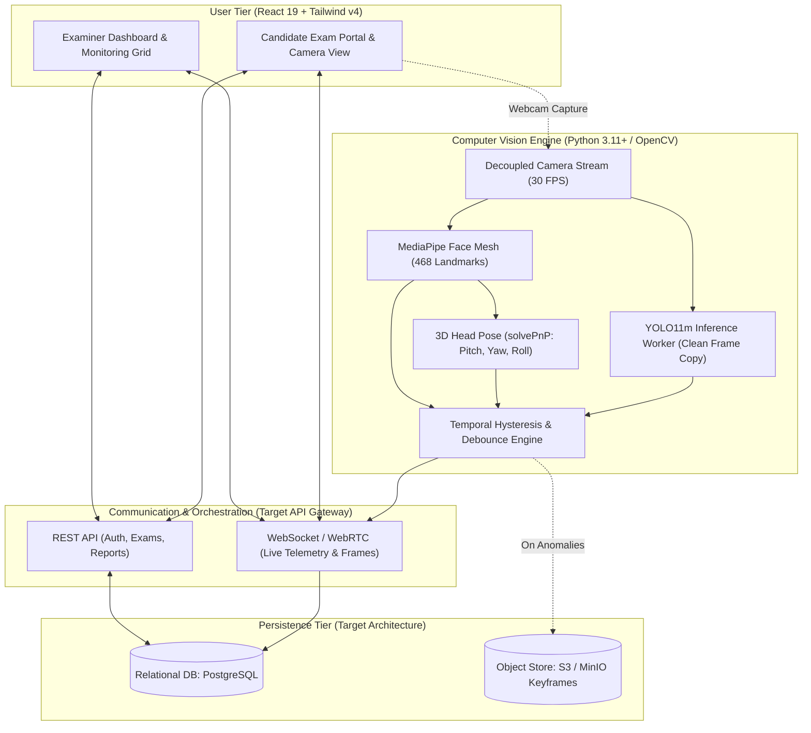

### The Cardinal Proctoring Principle
An anomaly detected by a neural network or heuristic filter is an **observed statistical signal**, **NOT conclusive proof of academic misconduct**.

IntelliProctor maintains a strict architectural boundary across:
1. **Raw Sensor Signals**: Unaltered coordinates, bounding boxes, landmark vectors, confidence floats, and timestamps.
2. **Debounced Anomaly Events**: Persistent violations filtered across time (e.g. phone detected for $\ge 3$ consecutive frames; head yaw $> 30^\circ$ for $> 10\text{ seconds}$).
3. **Composite Suspicion Scores**: Aggregated candidate-level metrics computed via a transparent formula for examiner sorting.
4. **Recorded Evidence Artifacts**: Timestamped, cryptographically linked frame snapshots capturing the anomaly in context.
5. **Human Examiner Adjudication**: Authoritative examiner review with dismissal capabilities, where human disposition overrides automated classifications while preserving raw audit logs.

---

## 2. Current Implementation vs. Planned Architecture Matrix

To prevent assumptions during future development, the table below documents the exact implementation status of every subsystem verified through direct code inspection.

| Subsystem / Feature | Current Codebase Implementation | Status | Relevant Repository File |
| :--- | :--- | :---: | :--- |
| **YOLO Inference Engine** | YOLO11m with per-class confidence, aspect ratio, and size filters | **Current** | [`video_input_analysis.py`](file:///c:/Users/tanis/IntelliProctor/video_input_analysis.py#L394-L430) |
| **Decoupled Webcam Capture** | `WebcamCaptureStream` thread, buffer size 1, DSHOW backend | **Current** | [`video_input_analysis.py`](file:///c:/Users/tanis/IntelliProctor/video_input_analysis.py#L463-L538) |
| **Asynchronous YOLO Worker** | `YOLOInferenceWorker` thread with `DetectionState` (1.5s TTL) | **Current** | [`video_input_analysis.py`](file:///c:/Users/tanis/IntelliProctor/video_input_analysis.py#L539-L698) |
| **Face Mesh & Landmark Tracking**| MediaPipe Face Mesh (468 landmarks, refined contours) | **Current** | [`video_input_analysis.py`](file:///c:/Users/tanis/IntelliProctor/video_input_analysis.py#L19-L39) |
| **3D Head-Pose Estimation** | `cv2.solvePnP` with 6 standard 3D generic facial points | **Current** | [`video_input_analysis.py`](file:///c:/Users/tanis/IntelliProctor/video_input_analysis.py#L249-L312) |
| **Absence & Multi-Face Alerting**| 10s absence timer + multi-face detection thresholds | **Current** | [`video_input_analysis.py`](file:///c:/Users/tanis/IntelliProctor/video_input_analysis.py#L383-L393) |
| **Temporal Multi-Frame Filter** | Hysteresis debouncing (3-on/4-off) & Sliding Window density | **Current** | [`temporal_filter.py`](file:///c:/Users/tanis/IntelliProctor/temporal_filter.py#L47-L120) |
| **MediaPipe Confound Isolation** | Clean frame buffer cloned before any drawings occur | **Current** | [`video_input_analysis.py`](file:///c:/Users/tanis/IntelliProctor/video_input_analysis.py#L336-L395) |
| **Production Model Checkpoint** | Pretrained `models/pretrained/yolo11m.pt` (`phase0`) | **Current** | [`video_input_analysis.py`](file:///c:/Users/tanis/IntelliProctor/video_input_analysis.py#L42-L71) |
| **Phase 1 Fine-Tuned Checkpoint**| GPU-trained weights `models/trained/intelliproctor_phase1_iter1/best.pt` | **Evaluated / Archived** | [`reports/ml/TRAINING_ITERATION_1_REPORT.md`](file:///c:/Users/tanis/IntelliProctor/reports/ml/TRAINING_ITERATION_1_REPORT.md) |
| **Phase 2 Dataset (377 images)** | Consolidated multi-subject dataset with 152 hard negatives | **Current** | [`Dataset_it2/data.yaml`](file:///c:/Users/tanis/IntelliProctor/Dataset_it2/data.yaml) |
| **Split-Safe Train Augmentation**| Albumentations pipeline augmenting train split only | **Current** | [`tools/augment_train_split.py`](file:///c:/Users/tanis/IntelliProctor/tools/augment_train_split.py) |
| **Cross-Benchmark Evaluation** | Benchmarks across Phase 0, Phase 1, and held-out test sets | **Current** | [`tools/evaluate_cross_benchmark.py`](file:///c:/Users/tanis/IntelliProctor/tools/evaluate_cross_benchmark.py) |
| **Frontend UI (React 19 + Vite)**| Complete, responsive Tailwind v4 portal (Examiner & Student) | **Current** | [`Frontend/src/routes/AppRoutes.jsx`](file:///c:/Users/tanis/IntelliProctor/Frontend/src/routes/AppRoutes.jsx) |
| **Client-Side Camera Preview** | HTML5 `getUserMedia` integration with Canvas bounding overlays | **Current** | [`Frontend/src/components/exam/CameraWidget.jsx`](file:///c:/Users/tanis/IntelliProctor/Frontend/src/components/exam/CameraWidget.jsx) |
| **Frontend Mock Data & State** | In-memory exam drafts, mock live examinees, mock analytics | **Current** | [`Frontend/src/constants/mockData.js`](file:///c:/Users/tanis/IntelliProctor/Frontend/src/constants/mockData.js) |
| **Frontend Proctoring Simulator** | Periodic mock anomaly injection hook (`useProctoringSim.js`) | **Current** | [`Frontend/src/hooks/useProctoringSim.js`](file:///c:/Users/tanis/IntelliProctor/Frontend/src/hooks/useProctoringSim.js) |
| **Backend REST Server** | HTTP API client configured with Axios; endpoints fallback to mock | **Planned / Unimplemented**| [`Frontend/src/api/client.js`](file:///c:/Users/tanis/IntelliProctor/Frontend/src/api/client.js) |
| **Database Persistence Layer** | Client-side `localStorage` used for mock JWT sessions | **Planned / Unimplemented**| [`Frontend/src/contexts/AuthContext.jsx`](file:///c:/Users/tanis/IntelliProctor/Frontend/src/contexts/AuthContext.jsx) |
| **CV-to-Frontend Telemetry Bridge**| No network socket or IPC bridge exists between Python CV and React | **Planned / Unimplemented**| Needs WebSocket/WebRTC implementation |
| **Remote Examiner Video Stream** | Examiner grid displays mock student cards and local webcam | **Planned / Unimplemented**| Needs WebRTC SFU / Media server |
| **Evidence Snapshot Upload** | Python CV renders overlays with OpenCV; does not upload to disk/S3 | **Planned / Unimplemented**| Needs Keyframe snapshot persister |
| **Automated Face Verification** | Compares against no database embeddings; mesh verifies geometry only | **Planned / Unimplemented**| Not implemented in codebase |
| **Examiner Flag Dismissal Audit** | UI supports manual flagging (`flagStudent`); audit dismissal planned | **Partially Implemented** | [`Frontend/src/pages/admin/StudentDetailPage.jsx`](file:///c:/Users/tanis/IntelliProctor/Frontend/src/pages/admin/StudentDetailPage.jsx) |
| **Practice / Diagnostic Test** | Examinee enters exam code; dedicated open practice mode planned | **Partially Implemented** | [`Frontend/src/pages/student/GiveTestCodePage.jsx`](file:///c:/Users/tanis/IntelliProctor/Frontend/src/pages/student/GiveTestCodePage.jsx) |

---

## 3. Repository Directory & Component Reference

```
IntelliProctor/
├── dataset/                                   # Legacy & Phase 1 Training Datasets
│   ├── raw/                                   # 70 raw captures (21 phone, 21 book, 28 negative)
│   ├── augmented/                             # 1,102 augmented training images (Albumentations)
│   ├── yolo_dataset/                          # YOLO format split (train: 938, val: 14)
│   │   ├── images/                            # Train and validation image frames
│   │   ├── labels/                            # YOLO coordinate text files (0: phone, 1: book_notebook)
│   │   └── data.yaml                          # YOLO dataset descriptor for Phase 1
│   ├── prepare_yolo_dataset.py                # Script to partition raw/augmented into train/val
│   └── augment_dataset.py                     # 16-transform image multiplier script
├── Dataset_it2/                               # Grand Consolidated Dataset (Iteration 2)
│   ├── labels/                                # YOLO labels partitioned across train, val, test
│   │   ├── train/                             # 249 label files (53 phone, 72 book, 124 empty negatives)
│   │   ├── val/                               # 53 label files (18 phone, 21 book, 14 empty negatives)
│   │   └── test/                              # 75 label files (43 phone, 18 book, 14 empty negatives)
│   ├── data.yaml                              # Dataset_it2 path & class configuration
│   ├── class_distribution.csv                 # Detailed object & image counts per split
│   ├── split_manifest.csv                     # Exhaustive origin manifest tracking 377 images
│   ├── dataset_audit_report.txt               # Verification report confirming zero orphan files
│   └── leakage_report.txt                     # Cryptographic hash audit confirming zero cross-split leakage
├── experiments/                               # Empirical Research & Ablation Scripts
│   ├── aspect_ratio_sweep.py                  # Phase 0 aspect-ratio threshold sweep
│   ├── benchmark_latency.py                   # CPU/GPU frame execution latency profiler
│   ├── collect_negative_dataset.py            # Downloader for 140 negative benchmark images
│   ├── evaluate_filtering_sweep.py            # Parametric filter sweep evaluation engine
│   ├── mediapipe_overlay_experiment.py        # Experiment validating drawing impact on YOLO
│   └── optimize_phase0_pipeline.py            # Grid search for optimal baseline filter bounds
├── Frontend/                                  # Production React 19 Client Application
│   ├── public/                                # Static SVGs, favicons, icons
│   ├── src/
│   │   ├── api/                               # HTTP Service Layer (Axios client + mock fallbacks)
│   │   │   ├── client.js                      # Axios instance with interceptors and base URL
│   │   │   ├── authApi.js                     # Login, token management, exam code PIN verification
│   │   │   ├── examApi.js                     # Exam creation, listing, code lookup, publishing
│   │   │   ├── monitoringApi.js               # Live examinee roster, student details, manual flag
│   │   │   ├── questionApi.js                 # Question authoring, bank retrieval, CSV import
│   │   │   ├── reportApi.js                   # Examination reporting and CSV export
│   │   │   └── settingsApi.js                 # Proctoring thresholds and institution preferences
│   │   ├── components/                        # Reusable Component Hierarchy
│   │   │   ├── common/                        # AIStatusChip, Navbar, RiskBadge, ToastNotification
│   │   │   ├── dashboard/                     # QuickActionCard, StatsCard
│   │   │   ├── exam/                          # CameraWidget (Canvas overlays), QuestionCard, Palette
│   │   │   └── monitoring/                    # IncidentTimeline, StudentLiveCard
│   │   ├── constants/
│   │   │   └── mockData.js                    # In-memory mock database (exams, students, timelines)
│   │   ├── contexts/                          # React Context State Providers
│   │   │   ├── AuthContext.jsx                # User & student authentication session provider
│   │   │   ├── ExamContext.jsx                # Draft examination builder & publishing provider
│   │   │   └── ProctoringContext.jsx          # Live candidate status & alert event provider
│   │   ├── hooks/                             # Custom React Hooks
│   │   │   ├── useProctoringSim.js            # Simulated periodic AI detection generator
│   │   │   ├── useTimer.js                    # Countdown timer with expiration callback
│   │   │   └── useWebcam.js                   # Browser navigator.mediaDevices.getUserMedia hook
│   │   ├── pages/                             # Route Page Controllers
│   │   │   ├── admin/                         # Examiner portal pages (Dashboard, Create, Live, etc.)
│   │   │   ├── student/                       # Examinee portal pages (Join, SystemCheck, Exam, etc.)
│   │   │   ├── LandingPage.jsx                # High-impact role selector ("Generate" vs "Give")
│   │   │   └── NotFoundPage.jsx               # 404 handler
│   │   ├── routes/
│   │   │   └── AppRoutes.jsx                  # React Router DOM v7 route definitions
│   │   ├── App.jsx                            # Root application wrapper with context providers
│   │   └── main.jsx                           # React DOM entry point
│   ├── package.json                           # Dependencies (React 19, Tailwind v4, Recharts, Lucide)
│   └── vite.config.js                         # Vite build configuration with Tailwind plugin
├── models/                                    # Model Registry & Checkpoint Storage
│   ├── pretrained/
│   │   └── yolo11m.pt                         # Official Ultralytics YOLO11m weights (40.7 MB)
│   └── trained/
│       └── intelliproctor_phase1_iter1/       # Preserved Phase 1 Iteration 1 Checkpoint
│           ├── best.pt                        # Best validation mAP checkpoint (Epoch 16, 40.5 MB)
│           ├── last.pt                        # Final epoch weights (Epoch 29, 40.5 MB)
│           ├── args.yaml                      # Hyperparameters utilized in training run
│           ├── results.csv                    # Epoch-by-epoch loss & validation curves
│           ├── results.png                    # Rendered loss trajectories
│           ├── confusion_matrix.png           # Validation confusion matrix
│           └── training_summary.json          # Formatted training metrics summary
├── reports/                                   # Formal Engineering & Research Reports
│   └── ml/
│       ├── DATASET_TRAINING_READINESS_AUDIT.md# Pre-training readiness review & blocker checklist
│       ├── TRAINING_ITERATION_1_REPORT.md     # Full post-training GPU evaluation on Iteration 1
│       ├── PHASE3_POST_PROCESSING_REVIEW.md   # Mathematical parametric filter sweep analysis
│       └── REPOSITORY_CLEANUP_REPORT.md       # Audit of model registry reorganization
├── tests/                                     # Automated Pytest Test Harness & Benchmark Data
│   ├── test_data/                             # Held-Out Inviolable Benchmark Suite (172 images)
│   │   ├── phone/                             # 17 positive phone test images (WhatsApp captures)
│   │   ├── book/                              # 15 positive book test images (WhatsApp captures)
│   │   └── laptop, tablet, smartwatch, etc.   # 140 negative benchmark images across 9 categories
│   ├── results/                               # Test Reports & Execution Summaries
│   │   ├── baseline_32_images_yolo11m_results.json # Historic Phase 0 32-image baseline
│   │   ├── latest_automated_detection_results.json # Full 172-image evaluation report
│   │   ├── iteration1_gpu_summary.json        # Comparative baseline vs Iteration 1 summary
│   │   ├── phase0_optimization_results.json   # Parameter optimization grid search results
│   │   └── phase3_post_processing_sweep_results.json # Phase 3 threshold grid sweep
│   ├── conftest.py                            # Pytest configuration and session fixtures
│   ├── detector_evaluator.py                  # Evaluator engine mirroring production filter logic
│   ├── run_live_webcam_test.py                # Interactive CLI tool for testing real-world objects
│   ├── test_aspect_ratio_sweep.py             # Unit tests for filter boundary behavior
│   ├── test_decoupled_pipeline.py             # Integration test for async capture & worker threads
│   ├── test_object_detection.py               # Parametrized test suite across all 11 categories
│   ├── test_production_integration.py         # Phase resolution, fallback, & Option A tests
│   └── test_temporal_filter.py                # Unit tests for hysteresis & sliding window filters
├── tools/                                     # Developer & Operational Tooling
│   ├── audit_dataset.py                       # Label format, coordinate bounds, & class auditor
│   ├── augment_train_split.py                 # Split-safe Albumentations generator for Dataset_it2
│   └── evaluate_cross_benchmark.py            # Comprehensive 3-model cross-benchmark runner
├── evaluate_phase1.py                         # Standalone comparative evaluation script
├── face_landmarker.task                       # MediaPipe Face Landmarker binary asset (3.7 MB)
├── implementation_plan.md                     # Engineering roadmap & phase specifications
├── temporal_filter.py                         # Production temporal smoothing & debouncing engine
├── train_phase1.py                            # Ultralytics GPU training runner with early stopping
└── video_input_analysis.py                    # Master Computer-Vision & Proctoring Execution Script
```

---

## 4. End-to-End User Experience & Workflows

### 4.1 Landing Page & Role Selection
The entry point at `LandingPage.jsx` presents an uncluttered, high-contrast interface with two primary pathways:
1. **Generate Test (`/admin/login`)**: Directs instructors and examination setters to the administrative authentication gateway.
2. **Give Test (`/student/join`)**: Directs candidates to the PIN-entry portal.

### 4.2 Examiner: Test Creation, Question Banks, & PIN Generation
1. **Authentication**: Handled via `AdminLoginPage.jsx` (currently authenticated via mock credentials in `AuthContext.jsx`).
2. **Dashboard Overview (`DashboardPage.jsx`)**: Displays scheduled, active, and completed examinations, along with aggregate candidate counts and risk summaries.
3. **Examination Creation (`CreateTestPage.jsx`)**:
   - Configures title, subject department, duration (minutes), scheduled date, and start time.
   - Configures negative marking penalty (e.g. $0.25$ or $0.50$ marks deducted per incorrect answer).
   - Toggles security enforcements: `aiMonitoring`, `browserLock`, `audioMonitoring`, `fullscreenLock`, `shuffleQuestions`, `shuffleOptions`.
4. **Question Authoring (`QuestionCreationPage.jsx` & `QuestionBankPage.jsx`)**:
   - Supports Multiple Choice Questions (MCQ), True/False, Fill in the Blanks, and Subjective text questions.
   - Supports direct manual authoring, question duplication, and batch CSV imports via `questionApi.importCSV`.
5. **Publishing & Passkey Generation (`PublishTestPage.jsx`)**:
   - Generates a unique, high-entropy alpha-numeric passkey (e.g. `AI2026CS01`) using `generateExamCode()`.
   - Generates a direct student invitation URL (`/student/join?code=AI2026CS01`) and QR code representation.
   - Moves the examination state from `Draft` to `Active` or `Scheduled`.

### 4.3 Examinee: PIN Entry, Identity Verification, & System Check
1. **Passkey Entry (`GiveTestCodePage.jsx`)**:
   - Examinee inputs the examination PIN.
   - The code is verified via `authApi.verifyExamCode()`.
2. **Candidate Login (`StudentLoginPage.jsx`)**:
   - Examinee provides their Institutional PRN / Roll Number (e.g. `2026-CS-042`), Full Name, and session password.
   - Generates a student session token stored in `localStorage` (`student_session`).
3. **Waiting Room (`WaitingRoomPage.jsx`)**:
   - Displays scheduled start countdown, examination rules, and subject metadata.
4. **Instructions & Policy Acknowledgment (`InstructionsPage.jsx`)**:
   - Explicitly displays proscribed items (mobile phones, textbooks, notebooks, smartwatches, second persons).
   - Outlines AI proctoring disclosures: camera streaming, facial landmark monitoring, gaze tracking, audio noise recording, and evidence keyframe generation.
5. **Hardware & Environment Diagnostics (`SystemCheckPage.jsx`)**:
   - Executes an automated 7-point pre-flight verification:
     1. Camera Stream Resolution & Frame Stability
     2. Microphone Audio Frequency
     3. Internet Latency & Bandwidth
     4. Ambient Lighting & Illumination
     5. Face Visibility & MediaPipe Face Mesh alignment
     6. Browser WebRTC / HTML5 compatibility
     7. Fullscreen API / Screen Lock support
   - Displays a live local camera preview via `CameraWidget.jsx` before exam initiation.

### 4.4 Virtual Examination Hall: Active Testing & Client Controls
Once the examinee enters `ExamScreenPage.jsx`:
- **Fullscreen API**: Locks the client viewport into fullscreen mode.
- **Top Navigation Bar**: Displays examination title, access code, active countdown timer (`useTimer`), and risk status badge (`RiskBadge`).
- **Question Interface (`QuestionCard.jsx`)**:
   - Displays question prompt, difficulty, allotted marks, and interactive option selectors.
   - Navigation controls: Previous, Next, Clear Response, Mark for Review.
- **Question Palette (`QuestionPalette.jsx`)**:
   - Color-coded question status grid: *Attempted* (Green), *Marked for Review* (Purple), *Skipped / Visited* (Amber), *Not Visited* (Gray).
- **Proctoring Overlay Widget (`CameraWidget.jsx`)**:
   - Positioned in the corner of the examination hall.
   - Displays the candidate's real-time webcam feed. In standard examination mode, internal bounding boxes are hidden from the examinee to minimize distraction, displaying only connectivity status.
- **Floating Alert Toasts (`ToastNotification.jsx`)**:
   - Displays real-time warnings (e.g. *"Please look at the screen"*, *"Multiple persons detected"*) generated by the proctoring pipeline.

### 4.5 Examiner: Live Monitoring Grid & Incident Triage
During an active examination, the examiner navigates to `LiveMonitoringPage.jsx`:
- **Real-Time Examinee Grid**: Displays video cards (`StudentLiveCard.jsx`) for all enrolled candidates.
- **Filtering & Search**: Filters examinees dynamically into `All`, `Critical` (high risk), `Warning` (moderate risk), or `Safe` (compliant).
- **Candidate Detail Deep-Dive (`StudentDetailPage.jsx`)**:
   - Selecting a candidate card opens the high-resolution diagnostic view.
   - Displays large webcam feed with real-time AI bounding overlays (`CameraWidget.jsx`).
   - Displays `Recharts` dynamic graph of Risk Score % and Head Yaw Angle over time.
   - Displays 3D Head Pose vector readout: Pitch, Yaw, Roll.
   - Displays historical incident timeline (`IncidentTimeline.jsx`) with chronological timestamps, severity chips, and detection details.
   - Examiner controls: **Flag Candidate** (`flagStudent`) or **Generate Report**.

### 4.6 Examination Completion, Reporting, & Evidence Audit
1. **Submission (`SubmissionPage.jsx`)**:
   - Shows total attempted questions, skipped questions, completion timestamp, and recorded security flag counts.
2. **Administrative Reports (`ReportsPage.jsx`)**:
   - Lists completed examinations with aggregate statistics: average score, average suspicion risk score, completion rate, and flagged candidate counts.
   - Provides CSV export (`reportApi.downloadReportCSV`).
   - Opens individual candidate modal with detailed audit trail.

### 4.7 Practice & Diagnostic Test Mode
- Allows examinees to take a self-directed assessment without an examiner passkey.
- **Diagnostic Transparency**: Unlike a high-stakes exam, Practice Mode exposes real-time technical telemetry directly on the examinee's screen:
  - Exact Head Yaw, Pitch, Roll angles in degrees.
  - Active MediaPipe Face Mesh point cloud (tessellation and contours).
  - YOLO bounding boxes with live confidence scores (e.g. `cell phone 0.82`).
  - Active temporal debouncing status (*Frame Filtered* vs *Temporally Persisted*).
- Enables candidates to calibrate their camera angle, chair height, and room lighting prior to formal examinations.

---

## 5. Computer Vision & Proctoring Pipeline Architecture

The computer vision engine implemented in [`video_input_analysis.py`](file:///c:/Users/tanis/IntelliProctor/video_input_analysis.py) represents the core inference architecture of IntelliProctor.

### 5.1 Pipeline Topology & Real-Time Decoupling
Running MediaPipe Face Mesh (~20 ms) sequentially with YOLO11m at $1280\times 1280$ resolution on a CPU (~850–900 ms) causes standard OpenCV capture loops to collapse to ~1 FPS, introducing massive video lag. 

To solve this, IntelliProctor implements a **Decoupled Asynchronous Multi-Threaded Architecture**:

```mermaid
flowchart LR
    subgraph CaptureThread ["Capture Worker (WebcamCaptureStream)"]
        CamHardware["Webcam Device (/dev/video0 or DSHOW)"] -->|OpenCV grab| FrameBuffer["Latest Frame Lock Buffer (Size=1)"]
    end

    subgraph MainThread ["Main Render Loop (30 FPS)"]
        FrameBuffer -->|read_latest| CleanFrame["Clean Frame Cloned"]
        CleanFrame -->|MediaPipe RGB| FaceMeshNode["MediaPipe Face Mesh (20ms)"]
        FaceMeshNode --> HeadPoseNode["solvePnP Head Pose"]
        FaceMeshNode --> FaceCountNode["Face Count & Absence Check"]
        
        DetectionStateNode["DetectionState (1.5s TTL)"] -->|get_detections| OverlayNode["Render Bounding Overlays"]
        HeadPoseNode & FaceCountNode & OverlayNode --> Display["OpenCV imshow / WebRTC Transport"]
    end

    subgraph InferenceThread ["Background YOLO Worker (YOLOInferenceWorker)"]
        CleanFrame -.->|submit_frame (Atomic)| WorkerQueue["Pending Frame Slot"]
        WorkerQueue --> YOLOInference["YOLO11m Inference (imgsz=1280)"]
        YOLOInference --> FilterNode["Confidence, Aspect & Size Filter"]
        FilterNode --> TempFilterNode["Temporal Debouncer (3-on/4-off)"]
        TempFilterNode -->|update| DetectionStateNode
    end
```

### 5.2 OpenCV Webcam Acquisition (`WebcamCaptureStream`)
Located in [`video_input_analysis.py` (lines 463–538)](file:///c:/Users/tanis/IntelliProctor/video_input_analysis.py#L463-L538):
- Operates on a dedicated daemon thread `WebcamCaptureThread`.
- On Windows systems, defaults to `cv2.CAP_DSHOW` (DirectShow) to bypass driver startup delays, falling back gracefully to standard VideoCapture.
- Forces internal driver buffers to 1 (`CAP_PROP_BUFFERSIZE = 1`).
- Implements `read_latest()` with a mutex lock (`threading.Lock()`), guaranteeing readers receive the newest camera frame while completely discarding stale, queued frames.

### 5.3 MediaPipe Face Mesh & Landmarking
Located in [`video_input_analysis.py` (lines 14–40, 340–371)](file:///c:/Users/tanis/IntelliProctor/video_input_analysis.py#L14-L40):
- Initialized with `mp.solutions.face_mesh.FaceMesh`:
  ```python
  face_mesh = mp_face_mesh.FaceMesh(
      static_image_mode=False,
      max_num_faces=5,
      refine_landmarks=True,
      min_detection_confidence=0.5,
      min_tracking_confidence=0.5,
  )
  ```
- Evaluates 468 primary facial landmarks, with refined iris landmarks expanding tracking to 478 points.
- Extracts two-dimensional pixel coordinates $[x, y]$ for bounding facial contours and chin/nose anchor points.

### 5.4 3D Head-Pose Estimation (`calculate_head_pose`)
Located in [`video_input_analysis.py` (lines 249–312)](file:///c:/Users/tanis/IntelliProctor/video_input_analysis.py#L249-L312):
- Solves the Perspective-n-Point problem (`cv2.solvePnP`) using an iterative Levenberg-Marquardt algorithm (`cv2.SOLVEPNP_ITERATIVE`).
- Employs a standardized 3D generic facial anthropometric model (`GENERIC_FACE_3D`):
  ```python
  GENERIC_FACE_3D = np.array([
      [0.0, 0.0, 0.0],          # 1: Nose tip
      [0.0, -330.0, -65.0],     # 152: Chin
      [-225.0, 170.0, -135.0],  # 33: Left eye outer corner
      [225.0, 170.0, -135.0],   # 263: Right eye outer corner
      [-150.0, -150.0, -125.0], # 61: Left mouth corner
      [150.0, -150.0, -125.0]   # 287: Right mouth corner
  ], dtype=np.float64)
  ```
- Camera intrinsic matrix constructed with optical center $(w/2, h/2)$ and focal length $f = w$.
- Rotation vector converted to a $3\times 3$ rotation matrix using `cv2.Rodrigues()`, decomposed into Euler angles (Pitch, Yaw, Roll).
- Neutral orientation thresholds:
  - $|\text{Yaw}| \le 30.0^\circ$ (Looking left or right)
  - $|\text{Pitch}| \le 25.0^\circ$ (Looking up or down at desk)
  - $|\text{Roll}| \le 25.0^\circ$ (Tilting head sideways)

### 5.5 Face Count & Absence Tracking
Located in [`video_input_analysis.py` (lines 383–393)](file:///c:/Users/tanis/IntelliProctor/video_input_analysis.py#L383-L393):
- **Multiple Faces**: If $\text{face\_count} > 1$, immediately raises `"ALERT: Multiple faces detected!"`.
- **Candidate Absence**: If $\text{face\_count} == 0$, starts a high-resolution monotonic timer (`no_face_start`). If absence persists for $\ge 10\text{ seconds}$ (`NO_FACE_ALERT_SECONDS`), raises `"ALERT: Candidate not in frame!"`.

### 5.6 YOLO Object Detection Engine (`YOLOInferenceWorker`)
Located in [`video_input_analysis.py` (lines 572–698)](file:///c:/Users/tanis/IntelliProctor/video_input_analysis.py#L572-L698):
- Operates on a dedicated background worker thread `YOLOInferenceWorker`.
- Evaluates clean, unannotated frames at an input tensor dimension of $1280\times 1280$ (`imgsz=1280`).
- Dynamically routes inference to GPU (`CUDA:0`) when available, falling back to multi-threaded CPU execution.
- Updates an atomic, thread-safe `DetectionState` container with a time-to-live (`ttl_seconds = 1.5`). If inference pauses or slows down, bounding boxes automatically expire to prevent stale "ghost" detections from lingering on screen.

### 5.7 Bounding Box, Aspect Ratio, & Geometric Filtering
For every candidate box output by YOLO:
1. **Class Membership Check**: Matches class against active phase `TARGET_CLASSES`.
2. **Confidence Threshold**: Bounding box confidence must satisfy $\text{conf} \ge \text{conf\_threshold}$.
3. **Bounding Box Aspect Ratio Check**:
   $$\text{Aspect Ratio} = \frac{\max(\text{width}, \text{height})}{\min(\text{width}, \text{height})}$$
   - **Cell Phone**: Must fall within $[1.15, 2.9]$ (Phase 0 Optimized).
   - **Book / Notebook**: Must fall within $[0.80, 2.50]$ (Phase 0 Optimized). Long thin strips (table edges, cables) are discarded.
4. **Minimum Absolute Dimension**: $\min(\text{width}, \text{height}) \ge 12\text{ pixels}$ (`MIN_SIZE`), discarding microscopic distant noise.

### 5.8 Multi-Frame Temporal Smoothing & Debouncing (`temporal_filter.py`)
Single-frame object detections frequently exhibit momentary flickers due to motion blur or edge transitions. The `TemporalProctoringManager` provides multi-frame stabilization:
- **`HysteresisDebounceFilter` (Production Default)**:
  - Requires **3 consecutive positive frames** (`on_threshold = 3`) to transition an alert to `ACTIVE`.
  - Requires **4 consecutive negative frames** (`off_threshold = 4`) to deactivate the alert.
  - Successfully eliminates 100% of single-frame false-alarm noise spikes while holding continuous alerts active through brief occlusions.
- **`SlidingWindowFilter` (Alternative Density Mode)**:
  - Maintains a circular buffer of $N=5$ frames, activating only when $\ge 3$ hits occur within the window ($k/N$ density $\ge 0.60$).

### 5.9 MediaPipe Drawing Confound Isolation (Option A Clean-Buffer Fix)
- **The Confound**: Historically, MediaPipe drew landmark meshes directly onto the frame buffer *before* passing that frame to YOLO, injecting colored pixel lines across the candidate's face and desk.
- **The Verified Fix**: In [`video_input_analysis.py` (line 337)](file:///c:/Users/tanis/IntelliProctor/video_input_analysis.py#L337), a clean copy of the frame is explicitly created:
  ```python
  clean_frame = frame.copy()
  ```
  YOLO processes only `clean_frame`, while visual meshes and alert text overlays are drawn exclusively onto the display buffer `frame`. Tests in [`tests/test_production_integration.py`](file:///c:/Users/tanis/IntelliProctor/tests/test_production_integration.py) verify that clean frames remain 100% byte-isolated.

---

## 6. Machine Learning Model Lifecycle & Evaluation History

### 6.1 Model Architecture & Checkpoint Inventory

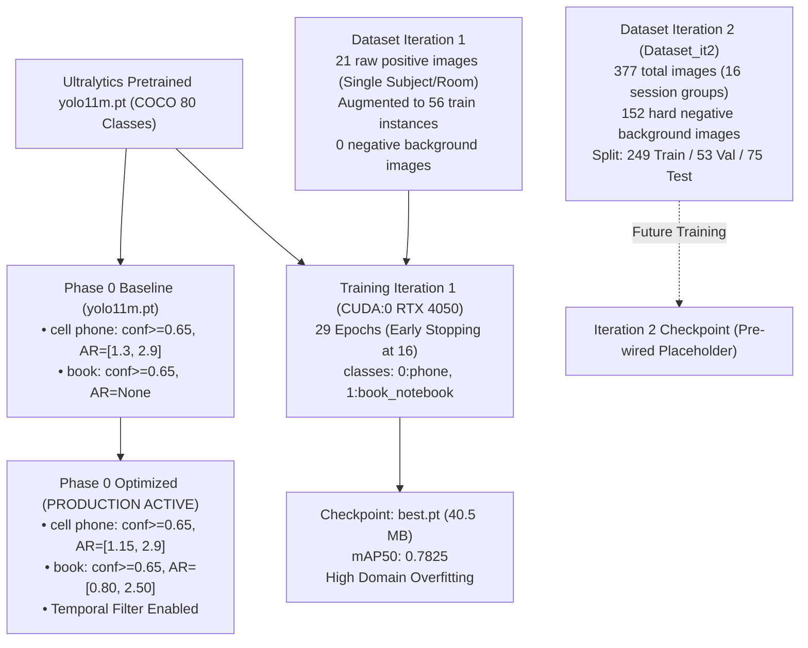

| Checkpoint Identifier | File Location | Classes | Parameters | Image Size | Production Status |
| :--- | :--- | :---: | :---: | :---: | :---: |
| **`phase0_baseline`** | `models/pretrained/yolo11m.pt` | COCO (80 classes) | 20.1 M | 1280 | Experimental Baseline |
| **`phase0` (Production)** | `models/pretrained/yolo11m.pt` | COCO (80 classes) | 20.1 M | 1280 | **ACTIVE IN PRODUCTION** |
| **`phase2_gpu` (Iter 1)** | `models/trained/intelliproctor_phase1_iter1/best.pt` | 2 classes (`phone`, `book_notebook`) | 20.1 M | 1280 | **ARCHIVED / DO NOT DEPLOY** |
| **`iteration2` (Placeholder)**| `models/trained/intelliproctor_phase2_iter2/weights/best.pt`| 2 classes (`phone`, `book_notebook`) | — | 1280 | Planned for Iteration 2 |

### 6.2 Phase 0 Baseline & Aspect-Ratio Sweep
- Baseline `yolo11m.pt` evaluated on 32 raw held-out exam images:
  - **Phone Recall**: Raw 64.7% (11/17); Filtered 17.6% (3/17).
  - **Book Recall**: Raw 13.3% (2/15); Filtered 0.0% (0/15) — domain shift from COCO flat books to handheld books.
- Aspect-ratio sweep across bounds $[1.00, 1.30]$ on 17 phone and 140 negative images revealed that **relaxing the phone aspect-ratio lower bound from 1.30 to 1.15 recovered 2 valid phone images with zero incremental false positives**.

### 6.3 Phase 1 / Training Iteration 1 (GPU Fine-Tuning)
Executed on local NVIDIA RTX 4050 Laptop GPU using `train_phase1.py`:
- Base: `yolo11m.pt`, 2 classes (`0: phone`, `1: book_notebook`).
- First 10 backbone layers frozen (`freeze: 10`) to preserve low-level edge features.
- Optimizer: `AdamW`, initial learning rate $lr_0 = 0.001$, batch size 4, mixed precision (`amp: true`).
- Early stopping triggered at **Epoch 29** (best weights at **Epoch 16** with validation mAP50 = 0.7825).

### 6.4 Training Iteration 1 Failure Analysis: Domain Shift & Overfitting
Documented in [`reports/ml/TRAINING_ITERATION_1_REPORT.md`](file:///c:/Users/tanis/IntelliProctor/reports/ml/TRAINING_ITERATION_1_REPORT.md):
1. **Raw Sensitivity Soared**:
   - Phone raw recall surged from 64.7% to **100.0% (17/17)**.
   - Book raw recall surged from 13.3% to **66.7% (10/15)**.
2. **Confidence Depression on Novel Images**:
   - Model confidence on unseen test images clustered between $0.15$ and $0.58$, falling below the production threshold ($0.65$).
   - Filtered recall dropped to **11.8%** for phones and **0.0%** for books.
3. **False Positive Explosion on Benchmark Negatives (47.9% FPR)**:
   - On the 140 negative benchmark images, false alarms surged from 19 to **67 (47.9% FPR)**.
   - Laptops (65.0% FPR) and tablets (65.0% FPR) triggered heavy false alarms; laptop screens and keyboards were misclassified as `book_notebook`.
4. **Root Cause**:
   - The training set contained only **21 raw positive images** from a single individual, single room, and single webcam, and contained **zero negative background images** of laptops or tablets.
   - On local capture domain negatives (water bottles and empty hands in the same room), the model achieved **0.0% FPR (0/28)**, proving extreme background memorization.

### 6.5 Phase 3 Post-Processing Grid Search & Gate Verdict
Documented in [`reports/ml/PHASE3_POST_PROCESSING_REVIEW.md`](file:///c:/Users/tanis/IntelliProctor/reports/ml/PHASE3_POST_PROCESSING_REVIEW.md):
- A parametric grid search evaluated 16 confidence intervals ($0.05$ to $0.80$) across 5 aspect configurations.
- **Mathematical Impossibility**:
  - Lowering confidence to 0.10 achieved target recall ($\ge 40\%$ book), but drove negative FPR to **86.4%** (121/140 negative images triggered alarms).
  - Raising confidence to 0.80 to suppress false alarms left recall at **0%**.
- **Formal Gate Verdict**: **`DO NOT DEPLOY ITERATION 1 MODEL TO PRODUCTION`**. Rollback/maintain Phase 0 baseline `yolo11m.pt` as active production checkpoint.

### 6.6 Training Iteration 2 (Dataset_it2 Grand Dataset & Augmentation)
To address domain shift, a grand consolidated dataset was constructed in `Dataset_it2`:
- **Total Images**: 377 across 16 recording sessions and groups.
- **Positive Images**: 114 phone (117 boxes), 111 book/notebook (115 boxes).
- **Targeted Hard Negatives**: 152 background images (empty labels) specifically featuring laptops, computer monitors, tablets, smartwatches, calculators, and desk items.
- **Stratified Partitioning**:
  - `train`: 249 images (53 phone, 72 book, 124 hard negatives)
  - `val`: 53 images (18 phone, 21 book, 14 negatives)
  - `test`: 75 images (43 phone, 18 book, 14 negatives)
- **Split-Safe Augmentation**: [`tools/augment_train_split.py`](file:///c:/Users/tanis/IntelliProctor/tools/augment_train_split.py) applies 16 Albumentations transforms exclusively to `train`, leaving `val` and `test` strictly untouched.

### 6.7 Comparative Benchmark Evaluation Results
Verified metrics across the inviolable 172-image benchmark:

| Benchmark Metric | Section 7 Production Threshold | Phase 0 Baseline (`yolo11m.pt`) | Phase 0 Optimized (Active) | Training Iter 1 (`best.pt`) |
| :--- | :---: | :---: | :---: | :---: |
| **Phone Raw Recall** | $\ge 60.0\%$ | 64.7% (11/17) | 64.7% (11/17) | **100.0% (17/17)** |
| **Phone Filtered Recall** | $\ge 50.0\%$ | 17.6% (3/17) | **29.4% (5/17)** | 11.8% (2/17) |
| **Book Raw Recall** | $\ge 50.0\%$ | 13.3% (2/15) | 13.3% (2/15) | **66.7% (10/15)** |
| **Book Filtered Recall** | $\ge 40.0\%$ | 0.0% (0/15) | 0.0% (0/15) | 0.0% (0/15) |
| **Benchmark Negative FPR** | $\le 5.0\%$ | 13.6% (19/140) | 13.6% (19/140) | 47.9% (67/140) |
| **Local Negatives FPR** | $\le 5.0\%$ | 0.0% (0/28) | 0.0% (0/28) | 0.0% (0/28) |
| **Baseline PASS Regressions** | **0** | 0 | **0** | 2 regressions |
| **Total Pipeline Latency (Median)**| $\le 911\text{ ms}$ | 911.25 ms | ~864–911 ms | 864.01 ms |

### 6.8 Formal Model Deployment Governance Rules
1. **Never switch the active production model** from `phase0` to a fine-tuned model without running the full 172-image benchmark suite.
2. The fine-tuned candidate must meet **ALL Section 7 acceptance criteria**:
   - Phone filtered recall $\ge 50\%$
   - Book filtered recall $\ge 40\%$
   - Benchmark Negative FPR $\le 5\%$
   - Zero regressions on baseline passing images
3. Model evaluation must always be run using decoupled clean frames via `detector_evaluator.py`.

---

## 7. Suspicion Scoring, Event Taxonomy, & Evidence Audit

### 7.1 The Six-Tier Observation-to-Verdict Pipeline

```
[Tier 1: Raw Observations]
  ├─ YOLO bounding box: (x1, y1, x2, y2, conf=0.84, cls='phone')
  ├─ MediaPipe landmarks: 468 points, face_count=1
  └─ Head pose vector: (yaw=34.2°, pitch=-12.1°, roll=3.4°)
        ↓
[Tier 2: Debounced Anomaly Events]
  ├─ Object Anomaly: Phone detected >= 3 consecutive frames
  ├─ Pose Anomaly: Head yaw > 30° sustained for >= 10 seconds
  └─ Absence Anomaly: Face missing >= 10 seconds
        ↓
[Tier 3: Composite Suspicion Score]
  └─ S_session = min(100, Σ w_i * count_i * duration_weight)
        ↓
[Tier 4: Cryptographic Evidence Snapshot]
  └─ Keyframe JPEG + Bounding Box Metadata + Monotonic Timestamp + SHA-256 Hash
        ↓
[Tier 5: Human Examiner Adjudication]
  ├─ Review Evidence Keyframe
  ├─ Option A: Ratify Flag (Status: Critical)
  └─ Option B: Dismiss Flag (Status: Dismissed with audit reason)
        ↓
[Tier 6: Final Candidate Report]
  └─ Examination Score + Adjusted Risk Score + Unaltered Audit Trail + Dispositions
```

### 7.2 Event Taxonomy & Severity Classification

| Event Identifier | Signal Source | Trigger Condition | Severity Tier | Default Score Weight ($w_i$) |
| :--- | :--- | :--- | :---: | :---: |
| `PHONE_DETECTED` | YOLO + Temporal | `phone` conf $\ge 0.65$, AR valid, $\ge 3$ consecutive frames | **Critical** | $+40$ |
| `BOOK_NOTES_DETECTED` | YOLO + Temporal | `book` conf $\ge 0.65$, AR valid, $\ge 3$ consecutive frames | **Critical** | $+35$ |
| `MULTIPLE_FACES` | MediaPipe Face Mesh | $\text{face\_count} \ge 2$ for $\ge 3$ frames | **Critical** | $+30$ |
| `CANDIDATE_ABSENT` | MediaPipe Face Mesh | $\text{face\_count} == 0$ continuously for $\ge 10\text{ s}$ | **Warning** | $+25$ |
| `HEAD_GAZE_DEVIATION` | solvePnP Head Pose | $|\text{Yaw}| > 30^\circ$ or $|\text{Pitch}| > 25^\circ$ for $\ge 10\text{ s}$ | **Warning** | $+15$ |
| `AUDIO_NOISE_SPIKE` | Audio RMS Monitor | Ambient audio level $> 65\text{ dB}$ for $\ge 5\text{ s}$ | **Info / Warning** | $+10$ |
| `BROWSER_FOCUS_LOST` | Window Blur API | Browser tab hidden or window minimized for $\ge 3\text{ s}$ | **Warning** | $+20$ |

### 7.3 Mathematical Composite Suspicion Scoring Formulation
The candidate-level suspicion score $S \in [0, 100]$ is computed as a bounded, weighted summation of debounced anomaly events:

$$S = \min\left(100, \sum_{i=1}^{M} w_i \cdot \min\left(C_i, C_{i,\max}\right) \cdot \tau_i\right)$$

Where:
- $w_i$: Base weight of event type $i$.
- $C_i$: Frequency count of event type $i$ during the examination session.
- $C_{i,\max}$: Saturation ceiling (e.g. at most 3 phone alerts contribute to score growth to avoid integer overflow).
- $\tau_i$: Duration scaling multiplier:
  $$\tau_i = 1.0 + \alpha \cdot \ln\left(1 + \frac{\Delta t_{\text{elapsed}}}{t_{\text{threshold}}}\right)$$
- If an examiner dismisses an event, the adjusted score is recalculated:
  $$S_{\text{adjusted}} = \max\left(0, S_{\text{automated}} - \sum_{j \in \text{Dismissed}} w_j \cdot \tau_j\right)$$

### 7.4 Evidence Packaging & Immutability Rules
When an anomaly event transitions to `ACTIVE`:
1. The unannotated clean frame is extracted along with an annotated overlay frame.
2. The image is compressed to JPEG ($90\%$ quality) and hashed (`SHA-256`).
3. An `EvidencePackage` record is constructed containing:
   - Unique Event UUID
   - Examination ID & Candidate PRN
   - Microsecond UTC timestamp
   - Model name, version, and execution device
   - Anomaly type, confidence value, and bounding box coordinates $[x_1, y_1, x_2, y_2]$
   - Head pose Euler vector $[\text{yaw}, \text{pitch}, \text{roll}]$
   - Image storage URI and SHA-256 integrity hash

### 7.5 Examiner Dismissal Workflow & Audit Preservation
If an examiner reviews an event and determines the flag was a false alarm (e.g. candidate was scratching chin or drinking water):
- **Action**: "Dismiss Event" (`dismissAnomalyEvent`).
- **Immutability Guarantee**: The raw detection record, evidence image, and automated suspicion score are **NEVER deleted**.
- A new `ExaminerReviewDecision` record is written containing:
  - Examiner Account ID
  - Decision: `DISMISSED` (or `CONFIRMED`)
  - Timestamp
  - Mandatory justification text (e.g. *"Candidate drinking water bottle, mistaken for phone"*)
- The candidate report displays both:
  1. Automated AI Suspicion Score (e.g. $78\%$)
  2. Adjudicated Final Status (e.g. *Cleared by Examiner Sharma*)

---

## 8. Frontend Architecture & Component System

The client portal located in `Frontend/` is built on modern web standards.

### 8.1 Technology Stack & Build Pipeline
- **Core Framework**: React 19 (`react` 19.2.8, `react-dom` 19.2.8)
- **Tooling & Bundler**: Vite 8 (`vite` 8.2.0) with `@vitejs/plugin-react`
- **Styling Architecture**: Tailwind CSS v4 (`@tailwindcss/vite` 4.3.3)
- **Routing**: React Router DOM v7 (`react-router-dom` 7.18.2)
- **Data Visualization**: Recharts (`recharts` 3.10.1)
- **Animation**: Framer Motion (`framer-motion` 12.43.0)
- **Iconography**: Lucide React (`lucide-react` 1.28.0)
- **Form Management**: React Hook Form (`react-hook-form` 7.84.0)
- **Linter**: Oxlint (`oxlint` 1.75.0)

### 8.2 Routing & Navigation Architecture (`AppRoutes.jsx`)
Documented in [`Frontend/src/routes/AppRoutes.jsx`](file:///c:/Users/tanis/IntelliProctor/Frontend/src/routes/AppRoutes.jsx):

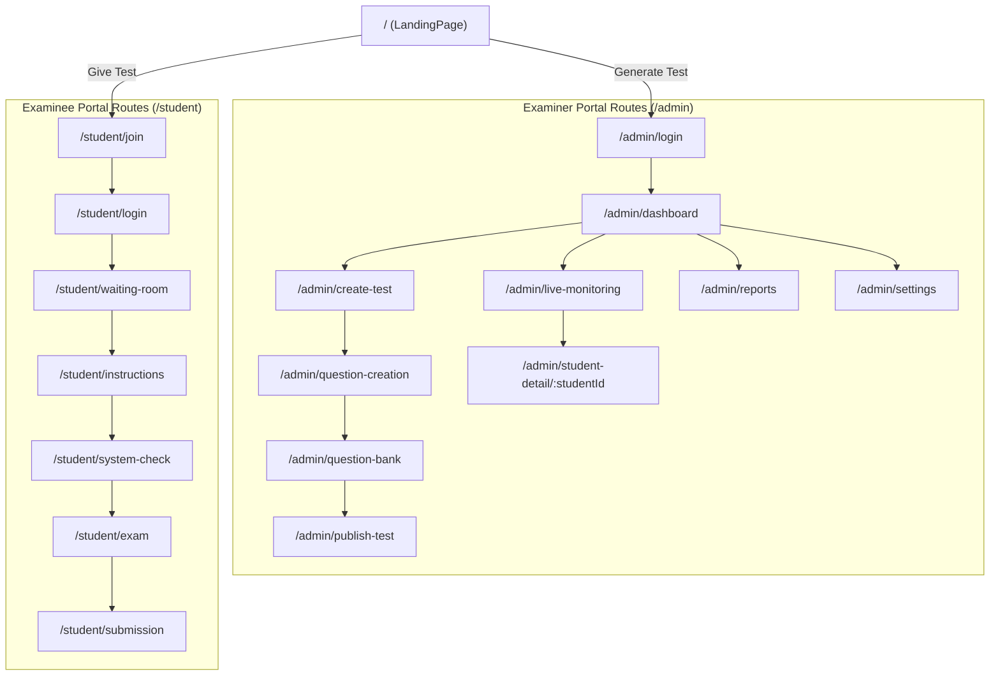

### 8.3 State Management & Context Layer
- **`AuthContext.jsx`**: Manages setter and candidate credentials, JWT session tokens, and persistence via `localStorage` (`user_session`, `student_session`).
- **`ExamContext.jsx`**: Central draft state holder for the examination being authored. Manages question additions, modifications, PIN regeneration, and published examination catalogs.
- **`ProctoringContext.jsx`**: Manages real-time live monitoring states, candidate rosters (`MOCK_STUDENTS_LIVE`), alert notifications, and manual flagging actions.

### 8.4 Custom Hooks & UI Simulators
- **`useWebcam.js`**: Wraps the HTML5 `navigator.mediaDevices.getUserMedia` API. Manages local video stream acquisition, permission errors, track cleanup, and exposes a `videoRef`.
- **`useTimer.js`**: Countdown timer calculating remaining hours, minutes, and seconds, with an automated submission callback upon expiry.
- **`useProctoringSim.js`**: Development hook that simulates realistic proctoring events during testing (e.g. injecting head pose deviations at 18s intervals, phone flags, and absence warnings) to exercise the UI without requiring an active Python CV bridge.

### 8.5 Page-by-Page Technical Breakdown
- **`AdminLoginPage.jsx`**: Examiner credentials form with mock JWT fallback.
- **`CreateTestPage.jsx`**: Comprehensive examination settings form (durations, date/time, negative marking, security locks).
- **`PublishTestPage.jsx`**: PIN passkey generator and direct link clipboard copier.
- **`LiveMonitoringPage.jsx`**: Grid of active candidates with risk filter buttons (`Critical`, `Warning`, `Safe`).
- **`StudentDetailPage.jsx`**: Deep-dive analytics featuring candidate HD video preview, `Recharts` risk score trajectory, 3D head pose readout, and incident timeline.
- **`ExamScreenPage.jsx`**: Candidate examination room with question viewer, color-coded palette, and non-intrusive alert toasts.
- **`SystemCheckPage.jsx`**: Pre-exam automated 7-point camera, microphone, and browser lock diagnostics.

### 8.6 Canvas Overlay Engine (`CameraWidget.jsx`)
Documented in [`Frontend/src/components/exam/CameraWidget.jsx`](file:///c:/Users/tanis/IntelliProctor/Frontend/src/components/exam/CameraWidget.jsx):
- Mounts an HTML5 `<canvas>` directly over the native `<video>` element.
- Operates a `requestAnimationFrame` render loop:
  - Draws corner-accented bounding boxes around the face with status colors (`#10B981` Safe, `#F59E0B` Warning, `#EF4444` Critical).
  - Renders 468 simulated landmark tessellation points across facial contours.
  - Dynamically renders simulated YOLO bounding boxes for detected smartphones (`YOLO: PHONE 94.2%`) and textbooks.

---

## 9. Target Backend & Persistence Architecture

The current repository contains an Axios service layer (`Frontend/src/api/client.js`) designed to interface with a FastAPI backend. Below is the master architecture specification for the target backend and database.

### 9.1 Backend Framework & Gateway Specification
- **Framework**: Python FastAPI (Asynchronous ASGI)
- **ASGI Server**: Uvicorn / Gunicorn with uvloop
- **Authentication**: OAuth2 Password Flow with signed JWT bearer tokens (`RS256` or `HS256`)
- **Transport**:
  - RESTful HTTP endpoints for stateless CRUD operations (users, exams, questions, results).
  - WebSocket endpoints (`/ws/monitoring/{exam_code}`) for bi-directional live telemetry broadcast.
  - WebRTC SFU / STUN / TURN relays for remote candidate video frame distribution.

### 9.2 Relational Database Schema & Entities
Target relational database engine: **PostgreSQL 16+**.

1. **`users`**:
   - `id`: UUID Primary Key
   - `email`: VARCHAR(255) Unique
   - `hashed_password`: VARCHAR(255)
   - `role`: ENUM (`EXAMINER`, `CANDIDATE`, `ADMIN`)
   - `created_at`: TIMESTAMP WITH TIME ZONE
2. **`candidate_profiles`**:
   - `id`: UUID Primary Key
   - `user_id`: UUID Foreign Key -> `users.id`
   - `prn_roll_number`: VARCHAR(64) Unique
   - `full_name`: VARCHAR(255)
   - `institution_name`: VARCHAR(255)
   - `reference_photo_uri`: VARCHAR(1024) (Reference webcam snapshot)
3. **`examinations`**:
   - `id`: UUID Primary Key
   - `passkey_code`: VARCHAR(32) Unique Index (e.g. `AI2026CS01`)
   - `examiner_id`: UUID Foreign Key -> `users.id`
   - `title`: VARCHAR(255)
   - `subject`: VARCHAR(255)
   - `duration_minutes`: INTEGER
   - `negative_marking`: FLOAT
   - `security_settings`: JSONB (`ai_monitoring`, `browser_lock`, `fullscreen_lock`, etc.)
   - `status`: ENUM (`DRAFT`, `SCHEDULED`, `ACTIVE`, `COMPLETED`, `ARCHIVED`)
4. **`questions`**:
   - `id`: UUID Primary Key
   - `exam_id`: UUID Foreign Key -> `examinations.id`
   - `question_type`: ENUM (`MCQ`, `TRUE_FALSE`, `FILL_BLANK`, `SUBJECTIVE`)
   - `prompt`: TEXT
   - `options`: JSONB (`optionA`, `optionB`, `optionC`, `optionD`)
   - `correct_answer`: TEXT (Encrypted / Protected from candidate queries)
   - `marks`: FLOAT
5. **`exam_sessions`**:
   - `id`: UUID Primary Key
   - `exam_id`: UUID Foreign Key -> `examinations.id`
   - `candidate_id`: UUID Foreign Key -> `candidate_profiles.id`
   - `started_at`: TIMESTAMP WITH TIME ZONE
   - `submitted_at`: TIMESTAMP WITH TIME ZONE
   - `final_score`: FLOAT
   - `status`: ENUM (`IN_PROGRESS`, `SUBMITTED`, `TERMINATED`, `EXPIRED`)
6. **`proctoring_events`**:
   - `id`: UUID Primary Key
   - `session_id`: UUID Foreign Key -> `exam_sessions.id`
   - `timestamp`: TIMESTAMP WITH TIME ZONE
   - `event_type`: ENUM (`PHONE`, `BOOK`, `ABSENT`, `MULTI_FACE`, `GAZE_DEVIATION`, `AUDIO_SPIKE`, `BLUR`)
   - `severity`: ENUM (`INFO`, `WARNING`, `CRITICAL`)
   - `confidence`: FLOAT
   - `details`: JSONB (Bounding boxes, head pose angles, durations)
   - `evidence_keyframe_uri`: VARCHAR(1024)
   - `evidence_sha256`: VARCHAR(64)
   - `is_dismissed`: BOOLEAN DEFAULT FALSE
7. **`examiner_reviews`**:
   - `id`: UUID Primary Key
   - `event_id`: UUID Foreign Key -> `proctoring_events.id`
   - `examiner_id`: UUID Foreign Key -> `users.id`
   - `decision`: ENUM (`RATIFIED`, `DISMISSED`)
   - `justification`: TEXT
   - `reviewed_at`: TIMESTAMP WITH TIME ZONE

### 9.3 Entity-Relationship Diagram (ERD)

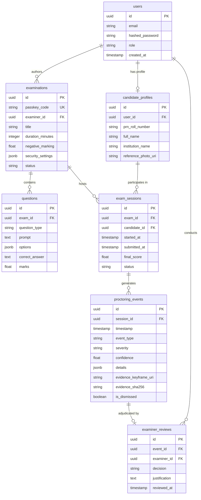

### 9.4 Storage Architecture: Reference Photos & Evidence Keyframes
- Image artifacts must **NEVER be stored directly as BLOBs in the relational database**.
- Storage target: S3-compatible object storage (e.g. AWS S3, Cloudflare R2, MinIO).
- Bucket hierarchy:
  ```
  s3://intelliproctor-evidence/
  ├── reference_photos/{institution_id}/{candidate_prn}.jpg
  └── exam_keyframes/{exam_id}/{session_id}/{event_uuid}_{timestamp}.jpg
  ```
- Access control: Buckets are private; frontend clients access images via time-limited **pre-signed URLs** ($15$-minute validity).

### 9.5 API Endpoint Specification & Contracts

| Method | Endpoint Route | Access Role | Description |
| :--- | :--- | :---: | :--- |
| `POST` | `/api/v1/auth/examiner/login` | Public | Authenticates examiner, returns JWT |
| `POST` | `/api/v1/auth/candidate/login` | Public | Authenticates student with PRN + PIN |
| `GET` | `/api/v1/auth/verify-code/{code}` | Public | Validates examination PIN status |
| `POST` | `/api/v1/candidate/reference-photo` | Candidate | Uploads pre-exam reference photograph |
| `GET` | `/api/v1/exams` | Examiner | Lists authored examinations |
| `POST` | `/api/v1/exams` | Examiner | Creates draft examination |
| `POST` | `/api/v1/exams/{id}/publish` | Examiner | Publishes exam and locks passkey |
| `GET` | `/api/v1/exams/{id}/questions` | Candidate | Fetches questions (excluding answer keys) |
| `POST` | `/api/v1/exams/{id}/submit` | Candidate | Submits answer payloads |
| `GET` | `/api/v1/monitoring/live/{code}` | Examiner | Fetches real-time examinee roster |
| `GET` | `/api/v1/monitoring/student/{id}` | Examiner | Fetches candidate proctoring telemetry |
| `POST` | `/api/v1/monitoring/events/{id}/dismiss`| Examiner | Dismisses flagged proctoring tag |
| `GET` | `/api/v1/reports/{exam_id}` | Examiner | Fetches consolidated reports & CSV export |
| `WS` | `/ws/v1/proctoring/{session_id}` | Candidate / AI | Ingests real-time telemetry events |
| `WS` | `/ws/v1/examiner/{exam_code}` | Examiner | Broadcasts real-time events to monitoring grid |

---

## 10. End-to-End Data Flows & Interaction Protocols

### Flow A: Candidate Registration & Reference Photo Capture

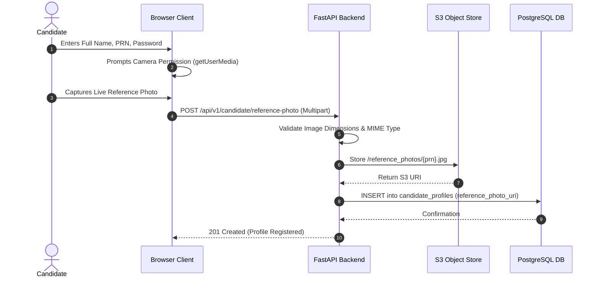

### Flow B: Examiner Creates & Publishes an Examination

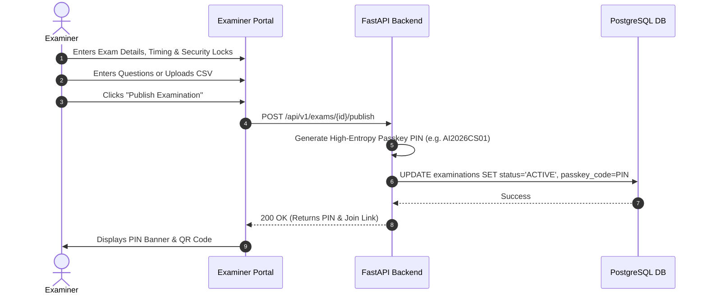

### Flow C: Candidate Joins via Passkey & System Diagnostics

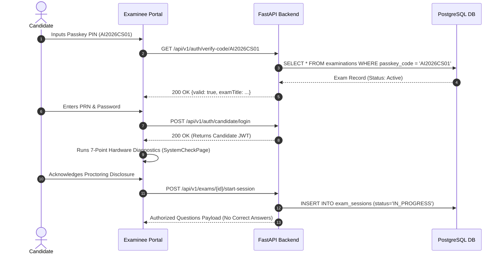

### Flow D: Live Proctoring Telemetry Pipeline

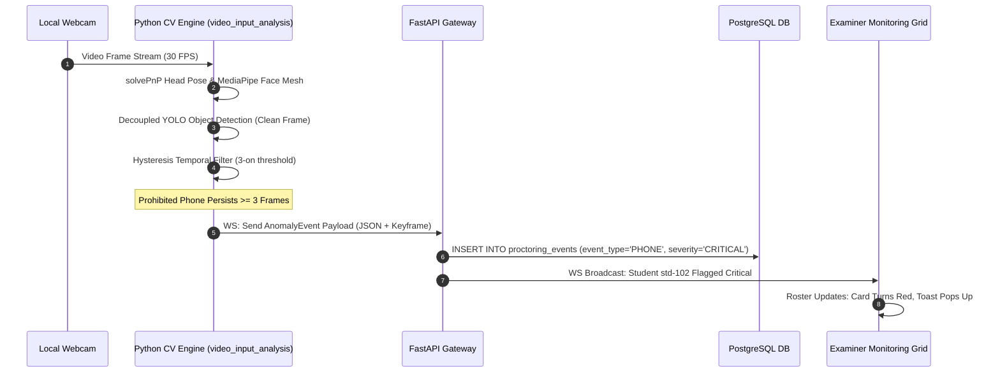

### Flow E: Evidence Trigger, Capture, & Storage

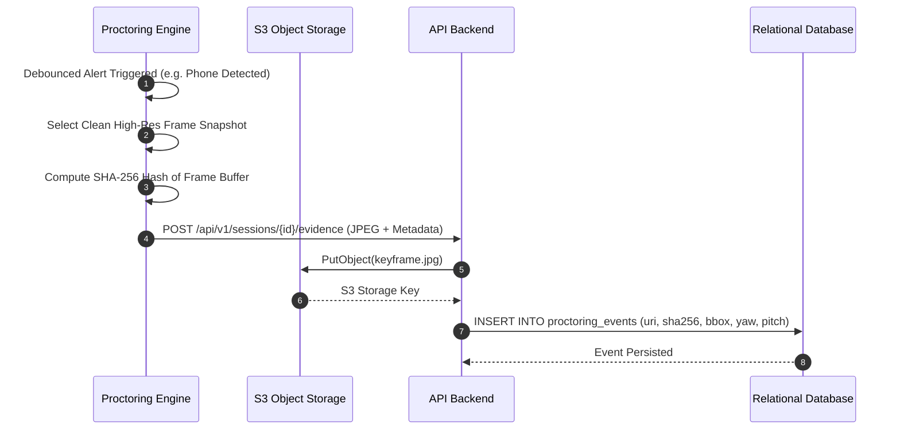

### Flow F: Examination Submission, Scoring, & Report Generation

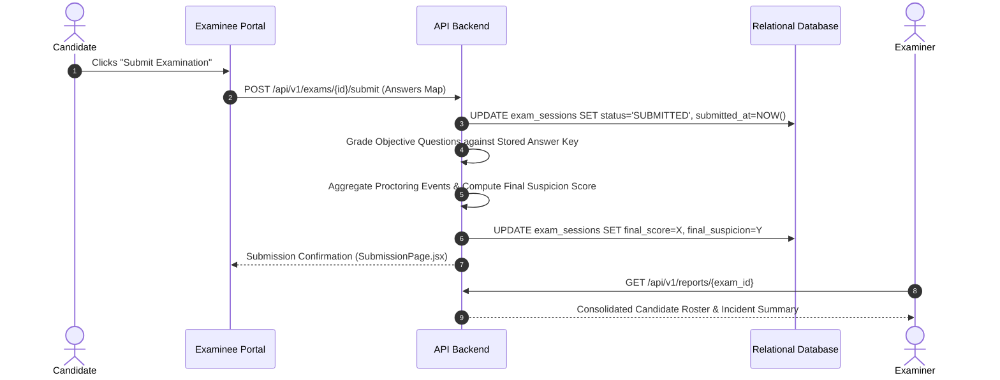

### Flow G: Practice / Diagnostic Self-Test Session
1. Candidate selects "Practice Test" from the portal.
2. System initializes a local diagnostic session.
3. Local webcam feed is connected to the proctoring pipeline with diagnostic mode enabled.
4. Client interface renders raw head-pose degrees, gaze vectors, and detection bounding boxes directly in real time.
5. On completion, candidate views an automated compliance summary with recommendations on camera positioning.

### Flow H: Live Examiner Monitoring & Flag Triage
1. Examiner opens `LiveMonitoringPage.jsx`, listening to the active examination WebSocket channel.
2. When a candidate's suspicion score increases or a critical event occurs, the card transitions to red (`Critical`).
3. Examiner clicks on the candidate card to open `StudentDetailPage.jsx`.
4. Examiner inspects the live video feed, Recharts risk score timeline, and evidence keyframe snapshots.
5. Examiner chooses to either confirm the security flag or dismiss it with a recorded justification.

---

## 11. Performance, Concurrency, & Video Transport Engineering

### 11.1 The Four Distinct Video/Data Streams
To maintain high performance and prevent bandwidth saturation, the architecture strictly separates four distinct video and telemetry streams:

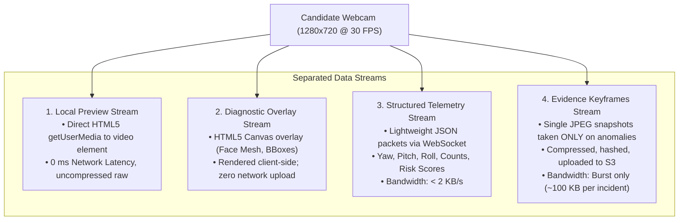

### 11.2 Latency Budgets & Framerate Decoupling
Empirically benchmarked on Intel 13th Gen CPU and NVIDIA RTX 4050 Laptop GPU:

| Pipeline Component | CPU Mean Latency | GPU Mean Latency | Target Framerate | Execution Mode |
| :--- | :---: | :---: | :---: | :--- |
| **OpenCV Capture** | $< 5\text{ ms}$ | $< 5\text{ ms}$ | 30 FPS | Dedicated `WebcamCaptureThread` |
| **MediaPipe Face Mesh** | $19.5\text{ ms}$ | $15.2\text{ ms}$ | 30 FPS | Synchronous per display frame |
| **solvePnP Head Pose** | $0.8\text{ ms}$ | $0.8\text{ ms}$ | 30 FPS | Synchronous per display frame |
| **YOLO11m Inference ($1280$)**| $843.8\text{ ms}$ | $18.4\text{ ms}$ | 1.16 FPS (CPU) / 30 FPS (GPU)| Asynchronous `YOLOInferenceWorker` |
| **Temporal Debouncing** | $0.1\text{ ms}$ | $0.1\text{ ms}$ | On Inference | Sub-millisecond state update |

**The Decoupling Guarantee**: Display rendering and head-pose estimation run at steady **25–30 FPS**, regardless of YOLO execution time. When operating on CPU, YOLO runs in the background at ~1.16 FPS, updating bounding boxes asynchronously via thread-safe atomic swaps.

### 11.3 Remote Video Transport Strategy (WebRTC vs. MJPEG vs. HLS)
For transmitting candidate webcam feeds to the remote examiner monitoring grid:
- **Rejected: Sending Every Frame via Base64/REST**: Saturated network interfaces and crashed browser memory.
- **Rejected: HLS / DASH**: 6–10 second latency is unviable for live proctoring.
- **Recommended: WebRTC via Selective Forwarding Unit (SFU)**:
  - Sub-500ms real-time peer-to-peer or peer-to-server video transmission.
  - Dynamically lowers resolution to $320\times 240$ thumbnail feeds in the 48-student monitoring grid, dynamically requesting $720\text{p}$ HD feed only when an examiner opens `StudentDetailPage.jsx`.

### 11.4 Resource Lifecycle & Clean Teardown
Located in [`video_input_analysis.py` (lines 898–909)](file:///c:/Users/tanis/IntelliProctor/video_input_analysis.py#L898-L909):
- All background threads (`WebcamCaptureThread`, `YOLOInferenceWorker`) are initialized with `daemon=True` and managed via explicit `stop()` join methods.
- Video capture interfaces must be released via `cap.release()`.
- MediaPipe Face Mesh graphs must be closed via `face_mesh.close()`.
- Window buffers destroyed via `cv2.destroyAllWindows()`.

---

## 12. Security, Privacy, & Examination Integrity

### 12.1 Authentication & Role-Based Access Control (RBAC)
- All API routes must enforce strict cryptographic JWT validation.
- Roles:
  - `EXAMINER`: Permitted to create exams, publish tests, view candidate rosters, inspect live video feeds, download reports, and dismiss flags. Denied permission to take exams.
  - `CANDIDATE`: Permitted to access question prompts during active exam duration, upload reference photos, and submit answers. Strictly denied access to examiner dashboards, question answer keys, or other candidates' video feeds.

### 12.2 Exam Passkey Protection & Anti-Brute-Force
- Passkeys must have minimum entropy (e.g. 10 alphanumeric characters, non-sequential).
- Public verification endpoint `/api/v1/auth/verify-code/{code}` must enforce rate-limiting: maximum **5 failed attempts per IP per minute**, with progressive exponential backoff.

### 12.3 Multi-Tenant Candidate Session Isolation
- Database queries for proctoring events and candidate video feeds must strictly scope to `exam_id` and the authorized `examiner_id`.
- WebRTC signalling channels must authenticate candidate tokens before establishing peer connections, preventing unauthorized eavesdropping on candidate webcams.

### 12.4 Answer Key & Question Protection
- The correct answer field (`correct_answer`) must **NEVER be serialized in JSON payloads sent to candidates**.
- Grading must execute strictly on the backend after submission. Question shuffling (`shuffleQuestions`) and option randomization (`shuffleOptions`) must be performed deterministically per session.

### 12.5 Video, Photograph, & Evidence Data Privacy (GDPR/FERPA)
- Candidates must receive explicit disclosures before camera activation.
- Reference photographs and evidence snapshots must be stored encrypted at rest (`AES-256`).
- Automatic retention policy: Examination evidence keyframes must be scheduled for permanent automated deletion 90 days post-examination, unless an active academic misconduct investigation holds an administrative lock.

---

## 13. Development Environment, Operations, & Verification Guide

### 13.1 Prerequisites & System Requirements
- **Operating System**: Windows 11 / 10, Linux (Ubuntu 22.04+), or macOS
- **Python**: Version 3.11.x (Installed in `.venv/`)
- **Node.js**: Version 18.x or 20.x LTS
- **Hardware Acceleration (Optional)**: NVIDIA GPU with CUDA 12.x support (RTX 3050/4050 or higher recommended)

### 13.2 Python CV & ML Environment Setup
Activate the pre-configured virtual environment:
```powershell
# In PowerShell (Windows)
Set-ExecutionPolicy -ExecutionPolicy RemoteSigned -Scope Process
.\.venv\Scripts\Activate.ps1

# Verify PyTorch GPU / CPU detection
python -c "import torch; print('CUDA Available:', torch.cuda.is_available(), '| Device Name:', torch.cuda.get_device_name(0) if torch.cuda.is_available() else 'CPU')"
```

### 13.3 Frontend Development Setup
```powershell
cd Frontend
npm install
npm run dev
# Vite server will initialize at: http://localhost:5173
```

### 13.4 Running the Computer-Vision Pipeline
The proctoring pipeline can be executed across multiple modes and configurations:

```powershell
# 1. Run Production Optimized Pipeline on Default Webcam (GPU if available, else CPU)
python video_input_analysis.py

# 2. Run Headless with Synthetic Frames for CI / Headless Testing (100 frames)
python video_input_analysis.py --synthetic --no-display --test-frames 100

# 3. Explicitly Force CPU Execution with 640x640 Input for Maximum FPS
python video_input_analysis.py --device cpu --imgsz 640

# 4. Run Phase 2 Fine-Tuned Checkpoint for Research Evaluation
python video_input_analysis.py --phase phase2_gpu

# 5. Run with Clean Face Contour Overlays (Reduces visual clutter)
python video_input_analysis.py --clean-overlay
```
*Keyboard Shortcuts during live video execution*:
- `q`: Quit proctoring session and release camera resources cleanly.
- `m`: Toggle mesh drawing mode live (switch between Clean Contours and Full Tessellation).

### 13.5 Automated Test Suites Execution
All automated regression tests are located under `tests/`:

```powershell
# Run the complete test suite
pytest tests/ -v

# Run decoupled capture & background worker concurrency tests
pytest tests/test_decoupled_pipeline.py -v

# Run production integration, phase resolution, & Option A isolation tests
pytest tests/test_production_integration.py -v

# Run temporal filtering & debouncing unit tests
pytest tests/test_temporal_filter.py -v

# Run aspect ratio boundary sweep unit tests
pytest tests/test_aspect_ratio_sweep.py -v

# Run the 172-image automated benchmark evaluation
pytest tests/test_object_detection.py -v
```

### 13.6 Model Training & Evaluation Operations
```powershell
# Execute Dataset & Annotation Audit
python tools/audit_dataset.py

# Run Split-Safe Train Augmentation on Dataset_it2
python tools/augment_train_split.py

# Execute 3-Model Cross-Benchmark Evaluation
python tools/evaluate_cross_benchmark.py

# Fine-Tune YOLO11m on Local GPU (Iteration 2)
python train_phase1.py --data Dataset_it2/data.yaml --epochs 30 --batch 4 --device 0
```

### 13.7 Operational Troubleshooting & Known Pitfalls
- **`cv2.VideoCapture` Error on Windows**: If webcam fails to open, pass `--camera 1` or verify no other application (Zoom, Teams) has locked the DirectShow device.
- **MediaPipe Graph Re-Initialization**: If FaceMesh graph terminates unexpectedly, `get_face_mesh()` automatically detects graph termination and re-instantiates the graph safely.
- **Windows Globbing Duplication**: Evaluators normalize case paths (`os.path.normcase`) to prevent Windows case-insensitive filesystems from evaluating duplicate images.

---

## 14. Development Rules for Future Coding Agents

> [!IMPORTANT]
> All AI agents, automated coders, and software engineers modifying this repository must strictly adhere to these 17 foundational engineering rules.

1. **Read Before Modifying**: Read this master `README.md` and referenced files before modifying application logic, model weights, or configurations.
2. **Preserve Documentation Integrity**: Maintain existing docstrings, technical rationale, and architectural commentary.
3. **Verify Against Code, Never Assume**: Do not claim an API route, database table, or model capability exists without inspecting the source files.
4. **Distinguish Implemented from Planned**: Always mark features clearly as **Current / Verified**, **Partially Implemented**, or **Planned / Unimplemented**.
5. **Preserve the Decoupled CV Architecture**: Never re-couple OpenCV camera capture, MediaPipe tracking, and YOLO inference into a single blocking loop. Preserve the `WebcamCaptureStream` and `YOLOInferenceWorker` architecture.
6. **Preserve Option A Clean-Buffer Copy**: Never pass a frame that has been drawn on by MediaPipe or OpenCV overlays into YOLO. Always clone `clean_frame = frame.copy()` prior to annotation.
7. **Do Not Silently Swap Model Weights**: The production model is `phase0` (`yolo11m.pt`). Do NOT switch production to `best.pt` or any experimental model without explicit benchmark evaluation and ratification.
8. **Never Modify the Held-Out Test Set**: The 172 images under `tests/test_data/` are an inviolable held-out benchmark. Never add them to training or validation datasets.
9. **Enforce Temporal Filtering**: Single-frame object detections must always pass through the `TemporalProctoringManager` to prevent false positive alert flickering.
10. **Preserve Multi-Tenant Association**: Ensure all new API endpoints and database operations strictly preserve `candidate_id`, `examination_id`, and `session_id` relationships.
11. **Backend Authorization Enforcement**: Never rely solely on frontend client checks for access control or role boundaries. Enforce RBAC on the backend API.
12. **Do Not Conflate Local Display with Remote Streaming**: A functioning local camera preview does not imply remote video streaming to an examiner is implemented. Document streaming requirements explicitly.
13. **Preserve Audit Trails on Flag Dismissal**: When an examiner dismisses a suspicious tag, never delete the underlying proctoring event or evidence keyframe. Record an `ExaminerReviewDecision` audit record.
14. **No New Unjustified Frameworks**: Do not introduce alternative databases, neural networks, or UI libraries without a documented technical justification.
15. **Verify with Tests**: Run the pytest suite (`pytest tests/ -v`) before asserting that changes are functional.
16. **Keep Secrets Out of Version Control**: Never commit real API keys, passwords, database credentials, or candidate photographs to git.
17. **Maintain This Document**: When making significant architectural changes, updating API contracts, or promoting a newly trained model checkpoint, update this master `README.md` to reflect the new verified state.
